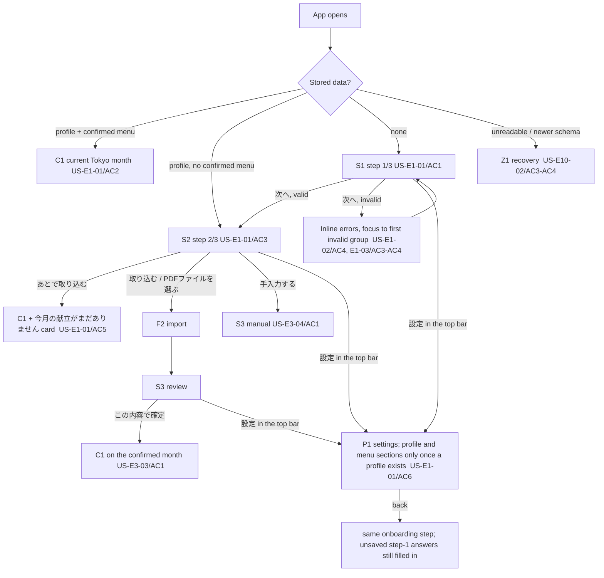
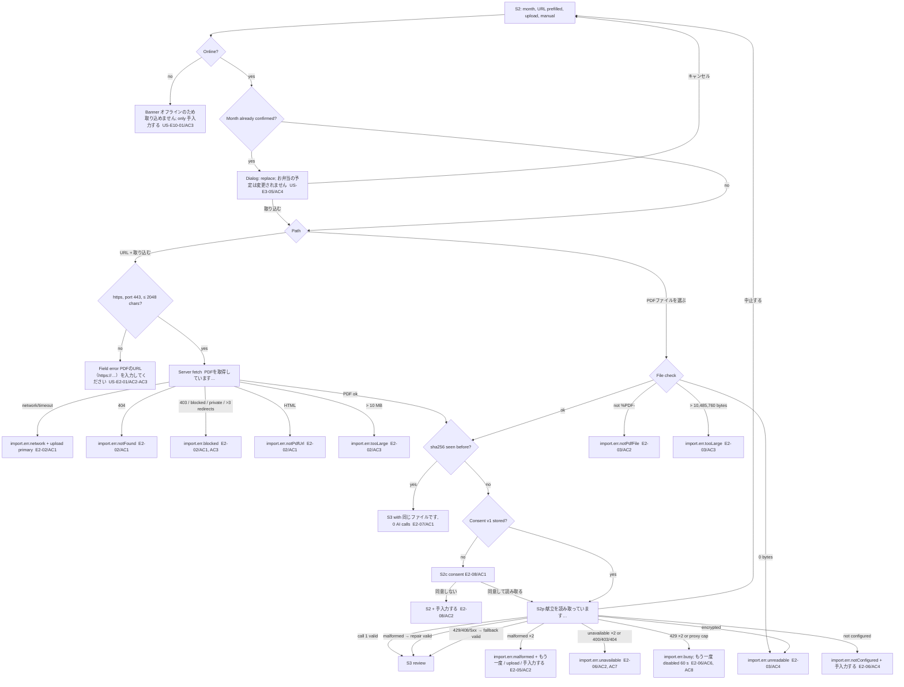
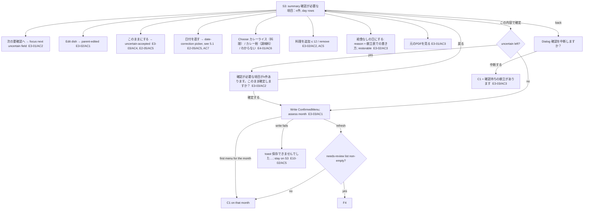
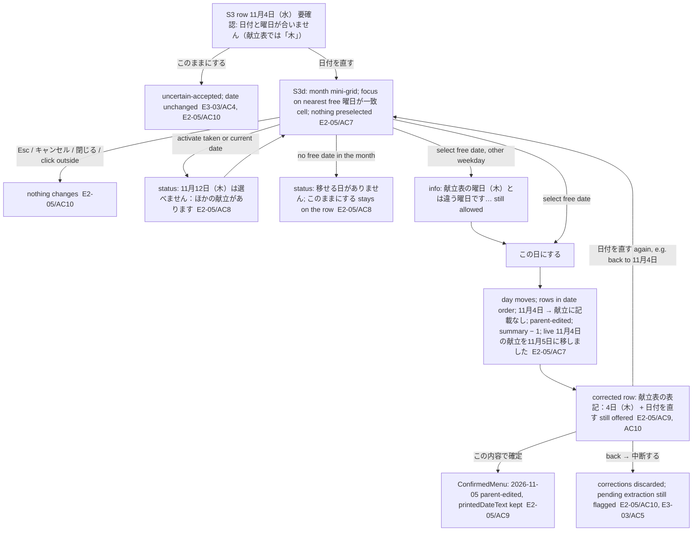
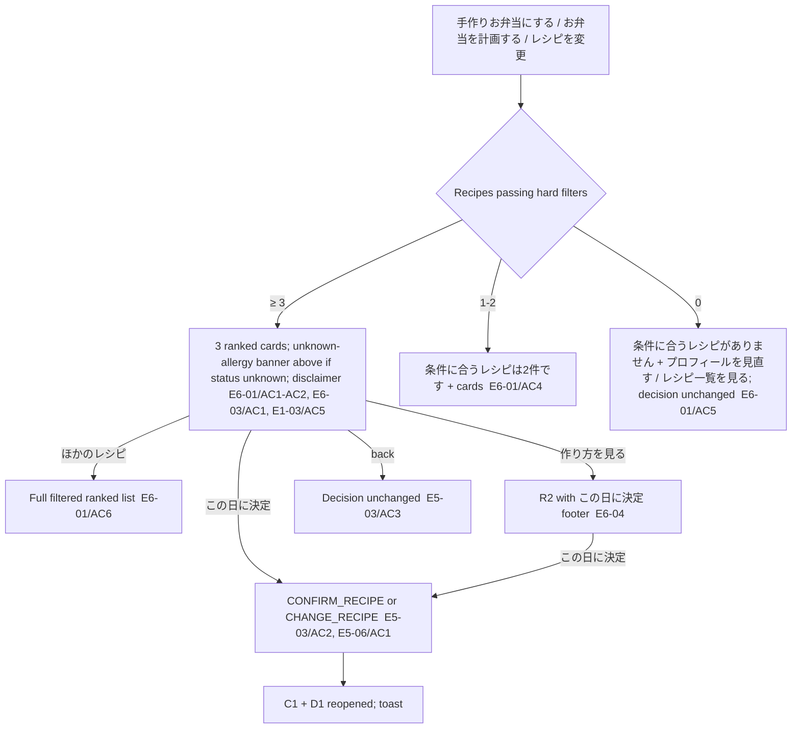

# BentoMinder: screens and flows v1.0

> Status: **H2 final**, 2026-10-24 (replaces the v0.2 direction draft). Every step cites the story/AC it serves (`docs/ba/user-stories.md`, H1 final). Strings are `design/copy.md` keys; components are `design/components.md` sections (§). A flow step without a story would be flagged **[no story]**: there are none left; the designer-only strings are listed at the end of `copy.md`.
>
> **Revision 2026-10-25 (M2 prep):** §5.1 F3a date correction on review (US-E2-05/AC5, AC7–AC10; taken dates are never chosen); F3 now names 「このままにする」 (the copy-sheet wording) instead of the draft 「このままでよい」.

## 1. Screen inventory

| # | Screen / surface | Type | Components | Stories |
|---|---|---|---|---|
| S1 | Onboarding step 1/3 「お子さまのこと」 | full screen, stepper | §6.1–6.4 | US-E1-01, E1-02, E1-03, E1-04 |
| S2 | Onboarding step 2/3 「献立の取り込み」 (also the import screen from calendar/settings) | full screen | §6.5 | US-E2-01, E2-02, E2-03, E1-01/AC3, AC5, E10-01/AC3 |
| S2c | AI consent | dialog | §6.7 | US-E2-08, NF-03 |
| S2p | Reading progress | full screen | §6.6 | US-E2-01/AC1, E2-04, E2-05, E2-06, E2-07, NF-04/AC3 |
| S3 | Onboarding step 3/3 「献立の確認」 (also refresh review, manual entry) | editable list | §6.8 | US-E3-01–E3-04, E2-04/AC2–AC5, E2-05/AC4–AC6, E4-01/AC6 |
| S3d | 「正しい日付を選んでください」 date correction (weekday mismatch) | bottom sheet < 768, dialog 768–1279, popover ≥ 1280 | §6.9 | US-E2-05/AC5, AC7–AC10 |
| S3r | 「確認が必要な日」 (refresh needs-review list) | list | §7 | US-E3-05/AC8, AC9, AC11, AC12 |
| C1 | Calendar home (reminders, today card, menu cards, upcoming, grid, legend, share) | home | §2, §8 | US-E5-01, E5-04, E5-05, E7-01–E7-03, E7-05, E3-03/AC3, E3-06, E8-04, E9-01 |
| D1 | Day sheet (bottom sheet < 768, dialog 768–1279, side panel ≥ 1280) | sheet/panel | §3 | US-E5-02–E5-08, E4-02, E4-03, E4-05, E3-05/AC2–AC3, AC6–AC8, E6-06, E1-05/AC2 |
| R1 | Recommendations | full screen | §4 | US-E6-01, E6-02, E6-03, E5-03, E5-06/AC1, E1-03/AC5 |
| R2 | Recipe detail (`/recipes/<id>`) | full screen | §5.1 | US-E6-04, E6-03, E5-06, E7-02/AC2 |
| R3 | Recipe library + plan-date picker | full screen + sheet | §5.2–5.3 | US-E6-05, E6-02/AC1, AC6, AC8 |
| P1 | Settings | full screen | §9 | US-E7-04, E7-06, E7-07/AC2, E8-01, E8-05, E5-01/AC8, E2-01/AC4, E3-05, E3-06/AC2, E1-05, E1-06, E10-03, E10-04 |
| P2 | Profile edit | full screen | §6.2 | US-E1-05 |
| H1 | Share sheet | sheet | §10 | US-E9-01, E9-02 |
| X1 | Debug panel | dev-only drawer | §13 | US-E11-01–E11-03, E2-07/AC3, E7-05/AC1 |
| Z1 | Recovery screens, storage banner, not found | full screen / banner | §12 | US-E10-02, E11-01/AC2, E6-04/AC3 |

**Navigation model.** No tab bar (PLAN §7). C1 is the only home. The app bar holds 「日本語 / EN」, レシピ (R3) and 設定 (P1) (US-E8-01/AC2). Every other screen has a back button and the language toggle. Maximum depth from the calendar for the main journey: C1 → D1 → R1 (2 levels; US-E0-01/AC3).

**Routes** (developer may rename, but each needs a reload/back behaviour): `/` (C1, `?month=YYYY-MM&day=YYYY-MM-DD` optional), `/onboarding/1|2|3`, `/import` (S2 outside onboarding), `/review/<YYYY-MM>`, `/refresh-review/<YYYY-MM>`, `/day/<date>/recipes` (R1), `/recipes` (R3), `/recipes/<id>` (R2), `/settings`, `/settings/profile`. `/debug` exists only in dev.

---

## 2. F0: end-to-end journey (US-E0-01)

Fresh device, ja, today 2026-10-28 10:00 JST, mocked AI returning the fixture extraction.

| # | Parent action (counted) | Screen → result | Story/AC |
|---|---|---|---|
| — | open the app | S1 step 1/3 (no data) | US-E1-01/AC1 |
| 1 | tap 「年中（4〜5歳）」 | chip selected | US-E1-02/AC1 |
| 2–4 | tap 鶏肉, たまご, とうもろこし in 好きな食べもの (popular chips) | 3 chips | US-E1-02/AC2 |
| 5–7 | tap ピーマン, なす, さかな in 苦手な食べもの | 3 chips | US-E1-02/AC2 |
| 8 | tap 「アレルギーあり」 | allergen picker opens | US-E1-03/AC1 |
| 9 | tap 「えび」 | chip selected | US-E1-03/AC1 |
| 10 | tap 「どうぶつ」 in すきなテーマ | chip selected | US-E1-04/AC3 |
| 11 | tap 「次へ」 | profile stored → S2 step 2/3 | US-E1-02/AC1 |
| 12–13 | tap 「PDFファイルを選ぶ」, pick `fixture-menu-2026-11.pdf` | file checked (`%PDF-`, ≤ 10 MB) | US-E2-03/AC1 |
| 14 | tap 「同意して読み取る」 | S2c closes → S2p 「献立を読み取っています…」 → S3 | US-E2-08/AC1, US-E2-04/AC1 |
| 15 | tap 「この内容で確定」 | fixture has 1 uncertain dish → dialog | US-E3-03/AC2 |
| 16 | tap 「確定する」 | ConfirmedMenu stored → **C1 opens on November 2026** (the month just confirmed) | US-E3-03/AC1, US-E0-01/AC1 |
| — | (look) | 11/4 shows the dashed ? mark and 「給食」; upcoming summary shows 「苦手かもの日が…」 | US-E5-01/AC3–AC4, US-E5-04 |
| 17 | tap 11月4日 | D1: explanation 「水曜日の給食には、苦手な食材が2つ含まれています（ピーマン、なす）。」, status 給食 | US-E4-02/AC1, US-E5-02/AC1 |
| 18 | tap 「手作りお弁当にする」 | R1: exactly 3 cards, none with alg-shrimp; decision still 給食 | US-E5-03/AC1, US-E6-01/AC1, US-E6-02/AC1 |
| 19 | tap 「この日に決定」 on card 1 | decision `homemade-bento-planned`; back to C1 with D1 open; toast `day.saved.bento`; cell 11/4 filled + short name; upcoming lists 「11月4日（水）」 + recipe | US-E5-03/AC2, US-E5-01/AC7 |
| — | debug clock 2026-11-03 17:30, 「前日のお知らせを表示」 (debug, not counted) | banner 「明日は手作りお弁当の日！レシピを確認しましょう。」 | US-E11-02/AC1–AC2, US-E7-02/AC1 |
| 20 | tap 「レシピを見る」 on the banner | R2 with ingredients, steps, disclaimer | US-E7-02/AC2, US-E6-03/AC1 |

**20 counted actions ≤ 25** (US-E0-01/AC3; 19 without the uncertain dialog). Depth ≤ 2 from C1.
**Reload** (US-E0-01/AC2): the app opens C1 on the **current Tokyo month** (October 2026), no onboarding; 「次の月」 → November shows 11/4 planned, unchanged (US-E1-01/AC2).
Keyboard-only: the same 20 actions with Tab/Enter/Space/arrows (a11y §5, US-NF-02/AC2).

---

## 3. F1: first launch and onboarding (US-E1-01…E1-04)



| Frame | What the parent sees | Story |
|---|---|---|
| S1 default | Stepper 1/3, hero line, fields: nickname (optional), age chips (required), likes/dislikes pickers, allergy radio (3 options, none preselected) + helper, diet chips, themes (≤ 3), note, 「次へ」 | US-E1-02/AC1–AC7, US-E1-03/AC3, AC6, US-E1-04/AC3 |
| S1 move | Picking a disliked food as liked moves it, announced 「「ピーマン」を苦手から好きに移しました」 | US-E1-02/AC3 |
| S1 limits | 21st nickname char not accepted; 4th theme refused with 「テーマは3つまで選べます」; 31st food refused | US-E1-02/AC5, US-E1-04/AC3, BR-20 |
| S1 errors | 「年齢を選んでください」; 「アレルギーについて、どれか1つを選んでください」; 「アレルギーの食材を1つ以上選んでください」; focus to the first invalid group | US-E1-02/AC4, US-E1-03/AC3–AC4 |
| S1 unknown | Choosing 「わからない・未確認」 previews the warning banner shown later on recipe screens | US-E1-03/AC5 |
| Reload on S2 | S2 is shown, S1 answers kept | US-E1-01/AC4 |
| Back from S2 | S1 with saved answers (editing is allowed) | US-E1-01/AC4 |
| Settings during onboarding | 設定 icon in the top bar on every step (components §1.2); export and delete-all work; back returns to the same step (M2 prep, D-M1-03 ruling) | US-E1-01/AC6, US-E10-03/AC2, US-E10-04 |

---

## 4. F2: import a menu (US-E2-01…E2-08, US-E10-01/AC3)

Entry points: S2 in onboarding; 「献立を取り込む」 on menu cards (C1), in the weekly reminder (US-E7-01/AC5) and in settings (US-E2-01/AC4).



| Error / fallback frame | Shown | Kept | Story |
|---|---|---|---|
| Any fetch error | Danger panel under the URL field with its message + 「入力したURLはそのまま残しています。」; 「PDFファイルを選ぶ」 becomes primary | URL in the field; 0 AI calls | US-E2-02/AC1 |
| Upload after a failed URL | Extraction runs on the file; source stores filename **and** URL | | US-E2-02/AC2 |
| AI failures | Panel with 「もう一度」, upload, 「手入力する」; 「もう一度」 starts a new import action (new budget of 2 calls) | Saved menus/plans byte-for-byte unchanged | US-E2-05/AC2, US-E2-06/AC2–AC3, US-E2-07/AC2, AC4 |
| Busy | Countdown 「もう一度（あと{s}秒）」 for retryAfterSeconds (60 default); enabled at once when absent | | US-E2-06/AC6 |
| Consent declined | No AI call; info 「AIは使いません。献立は手入力できます。」 + 「手入力する」 | | US-E2-08/AC2 |
| Notice version changes | Consent dialog shows again before the next extraction | | US-E2-08/AC3 |
| Reload during S2p | The import action is abandoned; S2 shows again (no partial data stored) | | US-E3-05/AC5 |

---

## 5. F3: review, edit, confirm (US-E3-01…E3-04)



| Frame | Notes | Story |
|---|---|---|
| Rows | Every Mon–Fri of the month in order, weekday labels; weekend dates only if listed; 「献立に記載なし」 for missing weekdays; 「給食なし」 + reason for no-lunch days | US-E3-01/AC1 |
| Uncertain | Warning-styled field + 「要確認」 tag + reason; day-level for weekday mismatch (shows the printed weekday) and duplicate dates (merged) | US-E2-04/AC4, US-E2-05/AC5–AC6, US-E3-01/AC2 |
| Missing data | 「材料の記載なし」; allergen line 「記載なし」 (never "none"); `declared-none` quotes the PDF | US-E2-04/AC2–AC3, BR-08 |
| Out of month | Collapsed 「対象月以外の日付（取り込みません）」 | US-E2-05/AC4 |
| Errors | 「料理名は1〜40文字で入力してください」 disables confirm; manual empty → 「少なくとも1日分を入力してください」 | US-E3-02/AC4, US-E3-04/AC2 |
| Manual entry | Same screen, every Mon–Fri empty, entries stored as `parent-entered`, source `manual` | US-E3-04/AC1 |
| Not confirmed | Nothing reaches C1 until confirmed; card 「確認待ちの献立があります」 reopens S3 | US-E3-03/AC3, BR-12 |
| After confirm | 0 homemade-bento days created | US-E5-04/AC2 |

### 5.1 F3a: correct a date (weekday mismatch) (US-E2-05/AC5, AC7–AC10)
Added 2026-10-25 (M2 prep). Everything happens in the review draft; nothing is stored before 「この内容で確定」. BA rule `review-date-correction` (contract §3.3): only free dates of the target month can be chosen; **a taken date is never overwritten, merged or swapped**.



| Frame | Shows | Error / fallback | Story |
|---|---|---|---|
| Row (before) | Day-level warning, 「要確認」 tag, reason with printed weekday, actions 「日付を直す」 · 「このままにする」; no-lunch and unflagged days have no 「日付を直す」 | — | US-E2-05/AC5, AC7, US-E3-01/AC2 |
| Picker | Title, context 「献立表では「4日（木）」です。いまは11月4日（水）になっています。」, target-month grid only (past dates included), markers + visible legend 「曜日が一致」「ほかの献立があります」「いまの日付」, status line | Apply disabled until a free date is chosen (「移す日を選んでください」); taken/current dates say why in the status line; a weekday different from the sheet only informs | US-E2-05/AC7, AC8 |
| No free date | Grid with every date disabled, 「移せる日がありません」, only cancel/close | 「このままにする」 on the row is the way out | US-E2-05/AC8 |
| Corrected | Row in its new place, 「献立表の表記：4日（木）」, 「日付を直す」 still there; old weekday shows 「献立に記載なし」; summary count − 1 | Move again (also back to the original date; the flag does not return) | US-E2-05/AC7, AC9, AC10, US-E3-01/AC1 |
| Whole week one day off | Fix from the free end first (e.g. Friday → free Saturday or next free date), then each previous day becomes free | No swap by design (BA rule) | US-E2-05/AC8 |
| Reload / back during the picker | The review keeps no draft (OQ-23): back opens 「確認を中断しますか？」 as for any review edit; a reload restarts the review from the extraction, flags included | — | US-E2-05/AC10, US-E3-03/AC5 |
| Manual entry, refresh review | Same screen; manual entries are never weekday-flagged, so 「日付を直す」 only appears on extracted days with `weekday-mismatch` (or corrected in this review) | — | US-E3-04, US-E3-05 |

---

## 6. F4: refresh a month and review conflicts (US-E3-05, rulings B6, B7, A57, S10, U5)

Trigger: import for a month that already has a confirmed menu (settings 「献立を確認・修正」 re-confirms the same extraction; 「献立を取り込む」 starts a new one).

```mermaid
flowchart TD
  I[Import for 2026-11, confirmed menu exists] --> D[Dialog: 置き換えますか？ お弁当の予定は変更されません  AC4]
  D --> X[F2 → S3 review of the new extraction]
  X -- cancel / fail --> Old[Previous menu stays active  AC5]
  X -- 確定 --> W[New ConfirmedMenu version; decisions and overrides untouched  AC1, BR-13]
  W --> RL[S3r 確認が必要な日: changed dates with override / bento planned / not-confirmed  AC9, AC11, AC12]
  RL -->|開く| D1[Day sheet of that date]
  D1 --> K{Case}
  K -- planned, date now no-lunch ≠ bento-day --> C2[Banner 献立が変わりました + 献立の更新で、この日は給食なしになりました… ; only このまま / 計画を取り消す  AC2]
  K -- planned, date removed --> C6[Banner + 献立の更新で、この日は献立表に載っていません… ; same 2 actions  AC6]
  K -- planned, date now bento-day --> OK[Not a conflict, no flag (BR-25)]
  K -- override, dishes changed --> O3[献立が変わりました。評価を見直してください。 override kept  AC3]
  K -- override, date now no-lunch / removed --> Dor[Override dormant: no 手動で変更 label, shows no-school-lunch / nothing  AC8, AC11]
  K -- not-confirmed / school-lunch record, date no-lunch / removed --> Dr[Dormant: no decision shown, no actions  AC12]
  C2 -->|このまま| Kp[KEEP_PLAN: state, recipe, plannedAt, reminder unchanged; leaves the upcoming summary; marker stays  AC7]
  C2 -->|計画を取り消す → confirm| Cl[Stored decision removed; displays no-school-lunch; reminder removed  AC7]
  Dor -. later refresh lists it as a school day .-> Re[Override applied again + 献立が変わりました。評価を見直してください。  AC8, AC11]
  Dr -. later refresh lists it as a school day .-> Re2[Record shown again unchanged  AC12]
```

| Frame | Shown | Story |
|---|---|---|
| C1 after a refresh with conflicts | Conflict cells: planned fill + warning badge; upcoming summary row 「献立が変わりました：{date}」 until このまま or clear | US-E3-05/AC2, AC7 |
| Reminder during a conflict | The day-before reminder still fires until the plan is cleared | US-E3-05/AC2, AC6, BR-17 |
| Planning a bento day that holds a dormant record | 「お弁当を計画する」 → R1 → confirm replaces the dormant record | US-E5-08/AC5 |
| Empty list | The S3r step is skipped; C1 opens | US-E3-05/AC9 |
| Coming back later | Settings 献立表 shows 「確認が必要な日（n件）」 while any listed date still has an open needs-review flag (derived from stored data, no new field; Orchestrator ruling M2 prep); resolved rows show a check; when none is open the link disappears and the route redirects to C1 | US-E3-05/AC9, AC7 |

---

## 7. F5: calendar home (US-E5-01, E3-06, E7-03, E8-04)

| Situation | What C1 shows | Story |
|---|---|---|
| Fresh open | Current Tokyo month, today marked (navy circle, `aria-current`), even if the device date differs | US-E5-01/AC1, US-E7-07/AC3 |
| Week start | Monday default (月…日, Sunday 11/1 in the last column of row 1); Sunday when set (日…土) | US-E5-01/AC2, AC8 |
| Month nav | 「前の月」/「次の月」, header 「2027年1月」; 「今日」 returns; Feb 2028 has 29 days | US-E5-01/AC5–AC6 |
| Each school day | Two indicators: assessment mark (top right) + decision (word/frame/fill) | US-E5-01/AC3–AC4, BR-03 |
| Upcoming summary | ≤ 3 planned days + conflicts + not-confirmed within 7 days + low-preference count; empty text | US-E5-01/AC7, US-E5-05/AC2 |
| Current/future month without a confirmed menu | Card 「12月の献立がまだありません」 (or 「今月の…」 if no menu was ever confirmed) + 「献立を取り込む」; weekdays render as numerals only (no assessment) | US-E3-06/AC1, US-E1-01/AC5 |
| From the 20th, next month missing | Card 「来月（12月）の献立を取り込みましょう」, once per day, dismissible for the day | US-E3-06/AC2 |
| Past month | No outdated warning | US-E3-06/AC3 |
| Holidays | Red numeral + 「祝」; name in the accessible name; a holiday with a menu lunch is a school day | US-E8-04/AC1–AC2 |
| Narrow / 200 % text | Agenda list instead of the grid | US-NF-02 (a11y §6) |
| Reload / back | Reload → current month; within a session, back from D1/R1/R2 returns to the month last viewed (kept in `?month`) | US-E1-01/AC2, US-E0-01/AC2 |

---

## 8. F6: day sheet, decisions (US-E5-02…E5-08, E4-05, E6-06, E1-05/AC2)

```mermaid
flowchart TD
  C1[Tap a date] --> T{Day type}
  T -- outside menu --> O[この日は献立に記載がありません, no actions  E5-02/AC2]
  T -- no-menu month --> NM[この月の献立はまだ取り込まれていません + 献立を取り込む  E3-06]
  T -- snack only --> SN[おやつ + おやつだけの日…, no actions  E4-01/AC10]
  T -- no-lunch other --> NL[給食なし + original text, no actions  E5-08/AC2]
  T -- bento day --> BD{planned?}
  BD -- no --> BDp[お弁当を計画する → R1  E5-08/AC1]
  BD -- yes --> BDy[レシピを見る / レシピを変更 / 計画を取り消す → dialog  E5-08/AC3]
  T -- school day --> P{Past?}
  P -- yes --> RO[Everything shown, no actions, 過去の日のため…  E5-02/AC3, BR-27]
  P -- no --> S{Decision}
  S -- school-lunch-planned --> A1[予約 note + checkbox; 手作りお弁当にする / あとで決める  E5-07]
  S -- not-confirmed --> A2[手作りお弁当にする / 給食に戻す  E5-05]
  S -- planned --> A3[レシピを見る / レシピを変更 / あとで決める / 給食に戻す → dialog  E5-06]
  S -- planned + refresh conflict --> A4[このまま / 計画を取り消す only  E3-05/AC2, AC6]
  A1 -->|手作りお弁当にする| R1[R1 — decision unchanged until confirm  E5-03/AC1]
  A1 -->|あとで決める| NC[not-confirmed, cell 未定 + outline  E5-05/AC1]
  A1 -->|tick 園で予約済み（自分で記録）| RS[reservationDoneExternally = true  E5-07/AC3]
  A2 -->|給食に戻す| SL[school-lunch-planned (no dialog)]
  A3 -->|給食に戻す| CD[Dialog 11月4日の手作りお弁当の予定を取り消しますか？  E5-06/AC3]
  CD -- キャンセル --> A3
  CD -- 取り消す --> SL2[school-lunch-planned; recipe link and reminder removed  E5-06/AC2, E7-02/AC6]
  A3 -->|あとで決める| NC2[not-confirmed; plannedAt cleared; reminder removed  E5-06/AC4, E7-02/AC6]
  A3 -->|レシピを変更| R1c[R1 change mode → new recipe; plannedAt kept; reminder kept, refers to new recipe  E5-06/AC1, E7-02/AC6-AC7]
```

| Extra frame | Shown | Story |
|---|---|---|
| Allergen declared on the menu | Warning row 「献立表に卵の表示があります。園にご確認ください。」; not-declared → 「アレルゲンの記載がありません」; assessment/decision unaffected | US-E4-05/AC1–AC3 |
| Planned recipe now has a registered allergen | Danger row 「選んだレシピに登録したアレルゲン（卵）が含まれています」 + 「レシピを変更」; decision kept; same row in the day-before reminder | US-E1-05/AC2 |
| Planned recipe removed from the library | Snapshot names; 「このレシピは見つかりません。別のレシピを選んでください。」 + 「レシピを選び直す」 | US-E6-06/AC1, US-E5-01/AC4 |
| Reservation flag + switch to bento | Planning clears `reservationDoneExternally` | US-E5-07/AC3 |
| Write fails | Toast 「保存できませんでした…」; state unchanged; sheet stays | US-E10-02/AC5, US-E10-05/AC1 |
| Close / back | Sheet closes, focus returns to the cell; nothing changes | US-E5-03/AC3 |

---

## 9. F7: assessment explanation and override (US-E4-02, E4-03)

| Step | Shown | Story |
|---|---|---|
| Open a school day | State chip + explanation from `explanationKey` (low / likely / mixedOne / mixedUnknown / mixedNeutral / notAssessed / noLunch) + 「判定は、登録した好みと…」 | US-E4-02/AC1–AC4 |
| 判定を変更 | Inline radio: たのしめそう / どちらとも / 苦手かも; choosing saves at once | US-E4-03/AC1 |
| After override | Label 「手動で変更」, 「アプリの判定は「…」でした。」 + calculated explanation; cell mark underlined; decision unchanged | US-E4-03/AC1, AC5, BR-01 |
| Persist | Survives reload, profile edit, reassessment, refresh | US-E4-03/AC2, BR-05 |
| 自動判定に戻す | Calculated state returns, label gone | US-E4-03/AC3 |
| No-lunch, past, outside | No override control | US-E4-03/AC4, BR-27 |
| No likes/dislikes | 「好きな食べもの・苦手な食べものが登録されていないため、判定していません。」 + 「好みを登録する」 | US-E4-01/AC8 |

---

## 10. F8: recommendations → recipe (US-E6-01…E6-04, E5-03)



| Frame | Shown | Story |
|---|---|---|
| Card | Name, minutes, ≤ 2 reasons (「好きな鶏肉入り」「どうぶつテーマ」), allergen badges, may-contain line | US-E6-01/AC2 |
| Processed ingredient, child with a registered allergen | Card, 「ほかのレシピ」 row, plannable library row and plan-date picker header: 「市販品の表示を確認」 (`warn.processed.card`). Detail: marker 「市販品。表示を確認」 on each processed ingredient + one notice above the ingredient list with the child's full allergen list (`warn.processed.recipe`). A recipe whose processed ingredient inherently contains a registered allergen never reaches these screens (excluded; library shows 「卵を含む」 greyed). No registered allergen (none-known, unknown, only excluded foods): none of these appear; the unknown-allergy banner and the disclaimer are unchanged | US-E6-02/AC9–AC12, US-E6-04/AC4–AC5 |
| Retired | 「市販品は製品によりアレルゲンが異なります…」 and the incomplete-data notice (no longer shown or ranked) | US-E6-02/AC4–AC6 superseded, US-E6-04/AC6 |
| No allergens in the recipe | 「表示対象のアレルゲン：使用していません（食品の表示をご確認ください）」 | US-E6-03/AC3 |
| Change mode | Current recipe tagged 「いまのレシピ」, its button disabled | US-E5-06/AC1 |
| R2 content | Name (en when EN), minutes, servings, ingredients, steps, storage + 農林水産省 notes, badges, theme, sources, disclaimer | US-E6-04/AC1–AC2, US-E8-01/AC4 |
| Deep link unknown id | 「レシピが見つかりません」 + 「カレンダーに戻る」 | US-E6-04/AC3 |
| Today / past | Today plannable; past dates never reach R1 (no action on D1) | US-E5-03/AC4 |

## 11. F9: recipe library (US-E6-05, E6-02/AC1, AC6, AC8)
App bar レシピ → R3: every recipe; conflicting ones last, greyed, with the reason (「卵を含む」 also for an inherent allergen of a processed ingredient, diet-incomplete, diet; the incomplete-allergen reason is retired) and plan disabled → open a recipe → 「日付を選んで計画」 → plan-date picker (school days and bento days from today) → 「この日に決定」 = same confirm as US-E5-03/AC2. Empty picker: 「計画できる日がありません。献立を取り込むと選べるようになります。」. Story: US-E6-05/AC1–AC2, US-E6-07 (content shown).

---

## 12. F10: reminders (US-E7-01, E7-02, E7-05, E7-06, E7-07, E5-05/AC3)

| Trigger (Asia/Tokyo) | Web behaviour (in-app only, BR-18) | Story |
|---|---|---|
| Weekly, default Sunday 14:00, covers the 7 days from the next day | Banner on C1 while open, or on the next open before it expires (end of the last covered day). Items: 「11月4日（水）苦手かも・未計画」 + 「計画する」; 「11月5日（木）未定」 + 「計画する」; 「11月6日（金）手作りお弁当：…」. Nothing: 「来週は手作りお弁当の予定はありません」. Month boundary: November days + 「12月の献立がまだありません」. No menu: 「来週の献立がまだありません」 + 「献立を取り込む」 | US-E7-01/AC1–AC5, US-E5-05/AC2 |
| 計画する | Opens that day's D1 | US-E7-01/AC2 |
| Day-before, default 17:30, planned days only (incl. bento days) | Banner 「明日は手作りお弁当の日！レシピを確認しましょう。」 + recipe + 「レシピを見る」 → R2 (or D1 if the recipe is missing) | US-E7-02/AC1–AC4, US-E5-08/AC4, US-E5-05/AC3 |
| First planned after the due time (`plannedAt ≥ dueAt`) | No banner; today card covers it next morning | US-E7-02/AC5, AC8 |
| Recipe changed after due, reminder not dismissed | Banner shows with the new recipe, labelled with its original time | US-E7-02/AC7 |
| Missed while closed | Shown on next open with 「11月3日（火） 17:30のお知らせ」 until it expires (00:00 JST on the target date) | US-E7-05/AC2 |
| Shown but not dismissed | Shown again on every open until dismissed or expired | US-E7-05/AC4 |
| Dismissed | Never again (debug 「強制表示」 only) | US-E7-05/AC1 |
| Several due | Day-before first, then weekly; extra ones under 「ほかにn件のお知らせ」 | US-E7-05/AC3 |
| Device not in Tokyo | Times labelled 「（日本時間）」 | US-E7-07/AC1–AC2 |
| Turned off | No banners of that type; today card still works | US-E7-04/AC4 |

The web limitation is stated in settings: 「ブラウザ版では、アプリを開いているとき・次に開いたときにお知らせします。閉じている間は通知できません。」 (US-E7-06/AC1). No string promises delivery while closed (US-E7-06/AC2).

## 13. F11: today card (US-E7-03)
Rendered at the top of C1 (below reminders). States: planned → 「今日は手作りお弁当：…」 + 「レシピを見る」; school lunch → 「今日は給食」 + reservation note + checkbox; not-confirmed → 「今日の予定は未定です」 + 「予定を決める」; no lunch → 「今日は給食がありません」 (bento day not planned: + 「お弁当を計画する」); weekend/outside → 「次の登園日：11月9日（月）給食」; nothing known → 「次の登園日は、献立を取り込むと表示されます」. Rolls over at Tokyo midnight without reload (US-E7-03/AC1–AC3, US-E5-07/AC1).

## 14. F12: settings (US-E7-04, E7-06, E8-01, E8-05, E5-01/AC8, E3-06/AC2, E2-01/AC4)
App bar 設定 → P1. Changes save at once and announce 「設定を保存しました」:
- お知らせ: 週のまとめ on/off + 曜日 + 時/分 (15-min steps); 前日のお知らせ on/off + 時/分; defaults 「日曜日 14:00」 and 「17:30」, both on; web limitation box. Changed times apply to future reminders; already-shown reminders aren't fired again (US-E7-04/AC1–AC4, PLAN §7 carry-over).
- 表示: 言語 (switches without reload, `<html lang>` updated, persists; US-E8-01/AC2–AC3); 週のはじまり 月曜日/日曜日 (grid only; US-E5-01/AC8); テーマ 自動/ライト/ダーク (US-E8-05/AC1–AC2).
- 献立表: saved URL, 「献立を取り込む」 (F2), 「献立を確認・修正」 (S3 for the shown month → F4 on confirm), 来月の献立のお知らせ day (US-E3-06/AC2).
- プロフィール: edit (F17), delete (F17).
- データ: export, import (Could), delete all (F14).
Errors: storage write fails → danger banner, control reverts (US-E10-02/AC5).

## 15. F13: share (US-E9-01, E9-02)
「今週の予定を共有」 → share sheet with the exact preview text, 「共有した時点の予定です。自動では同期されません。」 and 「お子さまのプロフィールは含まれません。」 → 「共有する」 (OS sheet) or 「コピーする」 → toast 「コピーしました」; share rejected/unavailable → copy; clipboard blocked → 「コピーできませんでした…」 + text selected. Empty week → 「今週は手作りお弁当の予定はありません。」. Text contains no profile data (BR-21).

## 16. F14: data export, delete, recovery (US-E10-01…E10-05)

| Path | Shown | Story |
|---|---|---|
| データを書き出す | Downloads `bentominder-export-YYYY-MM-DD.json` (Tokyo date); toast 「書き出しました」; disabled with 「書き出すデータがありません」 when empty | US-E10-03/AC2, AC4 |
| データを読み込む (Could) | File pick → validate (≤ app schema) → dialog 「今のデータを置き換えますか？」 → replace → C1; invalid/newer file → error line | US-E10-03/AC3 |
| すべてのデータを削除 | Dialog (one confirmation) → 「削除する」 removes every BentoMinder key → S1 in Japanese; キャンセル → unchanged | US-E10-04/AC1–AC2, BR-22 |
| Storage unavailable | Persistent danger banner 「この端末に保存できません」; no "saved" toasts | US-E10-02/AC5 |
| Newer schema | Recovery screen 「新しいバージョンのデータです。アプリを更新してください。」 + export; writes nothing | US-E10-02/AC3 |
| Corrupt store | Recovery screen with 「データを書き出す（そのまま）」 / 「初期化する」 (dialog); writes nothing until chosen | US-E10-02/AC4 |
| Old schema | Migrated once with a backup; info toast | US-E10-02/AC2 |
| Offline | Everything works except import (「オフラインのため取り込めません」) | US-E10-01/AC3, US-NF-04/AC1 |
| Invalid write refused | Toast 「保存できませんでした…」; previous state remains | US-E10-05/AC1 |

## 17. F15: language and theme (US-E8-01…E8-05)
First launch is Japanese whatever the browser language (`<html lang="ja">`). The toggle is in the app bar of C1 and every top bar (≤ 1 tap). EN switches all catalog text without reload; dish names stay Japanese; recipes use the English name when present; dates follow US-E8-03 formats; no 令和. Delete-all returns to Japanese. Theme follows the device by default; manual choice persists; in both themes only planned cells are solid-filled (US-E8-01/AC1–AC4, US-E8-02, US-E8-03, US-E8-05/AC3).

## 18. F16: debug panel (dev builds only; US-E11-01…E11-03)
「Debug」 pill (bottom-left) → drawer: simulated clock (set, +1分/時間/日, 「実時間に戻す」), 「週のまとめを表示」/「前日のお知らせを表示」 (debug-triggered, not logged), 「強制表示」, 「サンプルのプロフィール」, 「サンプルの献立（2026年11月）」 (opens S3 without AI), AI failure mode select (6 modes, each reproducing its story's frame in F2), 「AI calls this month: n」, decisions/overrides tables, 「テストデータを消去」 (dialog). Production: no pill, `/debug` → not found, no marker strings (US-E11-01/AC2, BR-24).

## 19. F17: profile edit and delete (US-E1-05, E1-06)
Settings → 「プロフィールを編集」 → P2 (same fields as S1) → 「保存」: assessments recalculated, decisions unchanged, toast; adding an allergy that a planned recipe contains → warning on that day and in its reminder (US-E1-05/AC1–AC2). 「キャンセル」 or back with changes → dialog → stored profile unchanged (US-E1-05/AC3).
「プロフィールを削除」 → dialog (menus and plans kept, manual changes removed) → profile removed, every assessment `not-assessed`, menus and decisions kept → next launch opens S1 without re-importing the menu (US-E1-06/AC1–AC3).

---

## 20. Story coverage (all 73)

| Story | Flow(s) | Story | Flow(s) | Story | Flow(s) |
|---|---|---|---|---|---|
| US-E0-01 | F0 | US-E4-01 | F1, F3, F7, F8 (§8 snack) | US-E7-01 | F10 |
| US-E1-01 | F1, F5 | US-E4-02 | F0, F7 | US-E7-02 | F0, F10 |
| US-E1-02 | F0, F1 | US-E4-03 | F7 | US-E7-03 | F11 |
| US-E1-03 | F0, F1, F8 | US-E4-04 | copy (state labels, banned words) | US-E7-04 | F12 |
| US-E1-04 | F0, F1 | US-E4-05 | F6 | US-E7-05 | F10 |
| US-E1-05 | F6, F17 | US-E5-01 | F0, F5 | US-E7-06 | F10, F12 |
| US-E1-06 | F17 | US-E5-02 | F6 | US-E7-07 | F5, F10 |
| US-E2-01 | F2 | US-E5-03 | F0, F6, F8 | US-E7-08 (v1) | copy §19 only |
| US-E2-02 | F2 | US-E5-04 | F0, F3 | US-E8-01 | F15 |
| US-E2-03 | F0, F2 | US-E5-05 | F6, F10 | US-E8-02 | F15 |
| US-E2-04 | F0, F2, F3 | US-E5-06 | F6, F8 | US-E8-03 | F15 |
| US-E2-05 | F2, F3, F3a | US-E5-07 | F6, F11 | US-E8-04 | F5 |
| US-E2-06 | F2 | US-E5-08 | F4, F6, F10 | US-E8-05 | F12, F15 |
| US-E2-07 | F2, F16 | US-E6-01 | F0, F8 | US-E9-01 | F13 |
| US-E2-08 | F0, F2 | US-E6-02 | F8, F9 | US-E9-02 | F13 |
| US-E3-01 | F3 | US-E6-03 | F0, F8 | US-E10-01 | F2, F14 |
| US-E3-02 | F3 | US-E6-04 | F8 | US-E10-02 | F1, F14 |
| US-E3-03 | F0, F3 | US-E6-05 | F9 | US-E10-03 | F14 |
| US-E3-04 | F2, F3 | US-E6-06 | F6 | US-E10-04 | F14 |
| US-E3-05 | F4, F6 | US-E6-07 | F9 (content only, no UI of its own) | US-E10-05 | F6, F14 |
| US-E3-06 | F5 | US-E11-01…03 | F16 | US-E12-01 | no UI (document) |
| US-NF-01 | loading budgets (components §1.12, §4.1) | US-NF-02 | a11y-responsive.md | US-E12-02…04 (v1) | copy §19 only |
| US-NF-03 | F2 (consent, payload box) | US-NF-04 | F2, F14 | US-NF-05 | no UI |

## 21. F18: sign in with Google, restore session, sign out (US-E13)
Screens: A0 restoring splash, A1 login, then the existing home (C1). Hard wall: nobody reaches C1 or any other screen signed out. The language toggle (`lang.toggle.*`) is on A1 (top right); elsewhere it stays in settings.

1. **Cold start** -> A0 (`auth.restoring`, spinner, no buttons) while the saved session is read. A1 is never rendered before this resolves, so a signed-in user never sees it flash.
2. **Session valid** -> straight to C1 (or onboarding step 1 if the device has no profile yet; sign-in never replaces onboarding). Signed in once, stays signed in across reloads and restarts.
3. **No session** -> A1 (idle). Tap `auth.google.button` -> button busy (`auth.google.signingIn`, `aria-disabled`, `aria-busy`), live `auth.signingIn.live`, Google window opens.
4. **Success** -> C1 (or onboarding). Local data on the device is kept and used as is.
5. **Errors** (all return to A1 idle, button enabled and focused, error line in an assertive live region, no data touched):
   - Google window closed -> `auth.error.cancelled`.
   - Pop-up blocked -> `auth.error.popupBlocked`.
   - No connection (also if it drops midway) -> `auth.error.offline`.
   - Anything else -> `auth.error.other`.
   - Offline cold start with a saved session: counts as signed in (session read locally), A0 -> C1. The wall applies only when there is no session.
   - Session read takes more than 8 s -> A1 with `auth.error.other`.
6. **Session expired or revoked while using the app** -> A1 with notice `auth.expired.*`; local data kept; after sign-in, back to C1.
7. **Sign out** (settings -> アカウント -> `auth.signOut`) -> confirm dialog (`auth.signOut.body`: data stays on this device) -> `auth.signOut.confirm` -> A1 with live `auth.signedOut.live`. Cancel / Esc -> back to settings, nothing changed. Failure -> `auth.signOut.failed` inside the dialog, dialog stays open.
8. **Signing in again** with the same account -> the local data is shown. A different account on the same device: not decided (see report); until decided, the device data is shown.
Stories: US-E13 (IDs to be filled).

## 22. F19: family sharing, cloud storage, sync status (US-E15-01…E15-11)
Screens and parts (components §16): S1 Family card (settings), S2 consent notice, S3 create progress, S4 invite block, S5 join screen + confirm, S6 adoption choice, S7 new-device loading / retry, S8 status button + sheet, S9 notes (banners), S10 leave / remove / delete dialogs, S11 import warning. Entry is always **settings -> 家族で共有** (S1) or a join link. Nothing here blocks the calendar, recipes, export or delete-all (US-E15-06/AC7).
Lazy-loaded: S2 to S6, S10, S11 and the status sheet / lost list of S8, S9. In the main bundle: the app-bar status button, S1 shell, S7.

### F19.1 Turn sharing on: create a family (US-E15-01, US-E15-02)
1. Settings S1, variant A: `family.none.lead`, buttons `family.create` and `family.join`. Nothing is uploaded, no request made (US-E15-01/AC1). In a family already: variant B, neither button (AC6).
2. Tap `family.create`. **Offline** -> `family.offline` in the card, no consent, no family (AC7).
3. Online -> S2 consent (first time, or the version upgrade state; skipped if the current version is already accepted). Nothing leaves the device before 「同意して進む」 (US-E15-02/AC1, AC8).
4. **Decline** (`consent.cloud.decline` or Esc) -> back to S1 variant A, toast `consent.cloud.declined.toast`; local only, no cloud change (US-E15-01/AC2, US-E15-02/AC4).
5. **Agree** -> S3 progress (`family.create.busy`); second tap ignored (US-E15-01/AC8). Consent recording fails -> `consent.cloud.error`, nothing stored (US-E15-02/AC8).
6. **Success** -> toast `family.toast.created`, S1 variant B, status chip appears (`synced` or `syncing`). Local data uploaded unchanged (AC3); empty local copy: identical screen, onboarding continues as normal (AC4).
7. **Network lost midway** -> S3 closes with the info banner `family.create.paused`; chip `pending-offline` / `retrying`; invite disabled (`family.invite.waitUpload`); resumes alone (US-E15-01/AC5).
8. Consent stored per member; readable later in S1 (`family.consent.row` -> read view with the date and the leave action) (US-E15-02/AC5, AC7).

### F19.2 Invite the spouse (US-E15-03)
1. S4 none -> `family.invite`. Disabled with hint when offline (`family.invite.offline`), upload unfinished (`family.invite.waitUpload`) or family full (`family.invite.full`) (AC9, US-E15-01/AC5, AC5).
2. Active: code in two groups, link, `family.invite.copyCode` / `copyLink` (toast), `family.invite.share` (if the device can), expiry `family.invite.expires` (72 h) (AC1). Copy blocked -> `family.invite.copyFailed`.
3. `family.invite.newCode` or `family.invite.cancel` -> the earlier code stops at once, one invite at most (AC4); toast `family.toast.inviteCancelled` for cancel.
4. Expiry reached -> S4 none + `family.invite.expired` (AC2).
5. Redeemed -> the member appears in the list, the invite is gone, toast `family.toast.joined` (AC8). Single use and rate limits act on the joiner's side (AC3, AC6).

### F19.3 Join with a code or link (US-E15-04, US-E15-03/AC6, AC7)
1. **Link, signed out** -> login (A1, F18) with `family.join.loginHint` -> sign in -> S5 with the code filled (AC1). **Link or settings, signed in** -> S5.
2. Type the code (any case, spaces or hyphens ignored) -> `common.next`. Fewer or more than 10 symbols: `family.join.err.format`, no request (AC2).
3. S2 consent if the version is not yet accepted (decline -> back to S5, nothing changed, AC8) -> confirm dialog (`family.join.confirm.*`; cancel changes nothing, AC8) -> `family.join.confirm.ok`.
4. **Refusals** (nothing changes, no family info, AC10): `family.join.err.generic` (wrong / used / cancelled), `.expired`, `.full`, `.rate` (10 tries an hour), `.already` (one family per account, AC9), `.offline`, `common.error.generic`.
5. **Success, local copy empty** -> download -> calendar with the family data, never onboarding (AC3); toast `family.toast.joinedSelf`.
6. **Success, local copy has data**
   - family empty -> no question, the local data is uploaded (AC7);
   - family has data -> S6 `family.adopt.title`: `family.adopt.useFamily` (preselected) or `family.adopt.addLocal`; `family.adopt.continue` or cancel (AC4). Use family: local replaced, backup copy kept 30 days and exportable (AC5). Add: family profile and settings stay, missing months, plans and overrides are added, same keys keep the family's version, backup copy kept (AC6).
7. **Interrupted** (app closed, network lost) -> next open: S7 container with `family.join.resuming`, then S6 if not yet answered; never a member with no way to finish (AC11).
8. After joining the new member has every control the creator has; the UI marks no owner (AC12).

### F19.4 First sign-in on a new device (US-E15-05)
1. Sign in (F18). Member, no local copy -> S7 loading (`family.load.title`), 15 s limit; no onboarding, no empty calendar flash (AC1).
2. Read fails or takes longer than 15 s -> S7 retry (`family.load.failed.title`, `family.load.retry`, or `family.load.failed.offline`); `auth.signOut` stays available; no local profile is created (AC3).
3. Read succeeds -> consent notice first only if this device has not recorded the current version (AC2), then the calendar.
4. Device with a local copy -> opens at once; membership check and sharing run in the background; offline is fine (AC4).
5. Account in no family, device has old data -> nothing changes; local only until the parent chooses (AC5).
6. Member whose device has different local data -> S6 once (`family.adopt.lead.device`), same outcomes as F19.3 step 6 (AC6).
7. Changes made on another device appear within 60 s without reload; reminders re-plan on this device (AC7); a changed allergy profile re-assesses plans with the existing "assessment changed" banner (AC8). Signing out here changes nothing for the family or other devices (AC9).

### F19.5 Status, offline and retry (US-E15-06, US-E15-10, US-E15-02/AC6)
1. App-bar status button (not shown while `local-only`) and the settings status row show one of: `synced`, `syncing`, `pending-offline`, `retrying`, `paused-no-consent`, `paused-limit`, `paused-app-too-old`, `membership-ended` (AC4). Tap -> status sheet (word, hint, last update, pending count, action).
2. Editing offline: saved at once on the device, chip `sync.pendingOffline`, queue shows the count (3 records, not 5 edits) and survives a restart (AC1, AC2). Online again -> `syncing` then `synced` with the time (AC3).
3. Temporary failure -> `sync.retrying`, no dialog; after 5 minutes `sync.retryNow` appears (AC5). Retry fails again -> `sync.retry.failed`.
4. Pending changes older than 24 h -> the chip is highlighted (ring, "!", `sync.stale.short`) and the sheet shows `sync.stale` (AC6).
5. New notice version -> consent upgrade state on the next open; decline -> chip `sync.needsConsent`, card banner `consent.cloud.paused.*` (US-E15-02/AC6).
6. Size limit -> `sync.limit` (US-E15-10/AC1); runaway write guard -> `sync.limit.writes`, resumes within the hour (AC3); cloud from a newer app -> `sync.appTooOld` + `sync.appTooOld.action` (US-E15-06/AC8). The local copy keeps working and export stays available in all of them (US-E15-06/AC7).
7. Notes (S9): a downloaded record that failed validation -> `family.ignored.title`, once (AC9). My pending edit lost to a newer family edit -> `family.lost.one.*` + `family.lost.show`; several -> `family.lost.many` + list (US-E15-07/AC8). Dismiss closes; never shown again.
8. Sign-out stops sending; the queue stays under the account's keys (US-E15-06/AC10). Reminder log and shown state are never shared (AC11).

### F19.6 Leave, remove, delete (US-E15-08)
All three need the network: offline, the destructive button is disabled with `family.offline.action` and nothing is queued (AC9). Cancel, Esc or backdrop changes nothing (AC8).
1. **Leave** (two members): `family.leave` -> dialog `family.leave.*` (says the other member keeps the data) -> `family.leave.confirm` -> toast `family.toast.left`; the device keeps its data as local only, chip disappears (`local-only`), S1 variant A (AC1, AC2, AC10).
2. **Last member leaving:** `family.leave` -> `family.leaveLast.*` with typed confirmation (`family.typed.*`) -> online data deleted, local kept (AC4).
3. **Remove the other member:** `family.remove` -> `family.remove.*` -> `family.remove.confirm` -> toast `family.toast.removed`; the list loses the row (AC3). On the removed person's device, at next open or sharing run: banner `family.ended.removed.*` (S9), their data kept as local only, S1 variant A after `family.ended.ok` (AC3).
4. **Delete the online data:** `family.delete` -> `family.delete.*` + typed `family.typed.word` -> `family.delete.confirm` -> toast `family.toast.deleted`; Google sign-in and every local copy stay (AC5, AC7). Other member's device at next open: banner `family.ended.deleted.*`, local data kept, nothing re-uploaded (AC6).
5. Failure in any dialog -> `common.error.generic` inside, dialog stays, nothing changed.
6. **Local "delete all"** (E10-04) while in a family: dialog shows `family.deleteAll.note` first; the online data stays; next sign-in downloads it again (US-E15-11/AC7, US-E15-08/AC7).

### F19.7 Import and export while in a family (US-E15-11)
1. Export is unchanged (`data.export`); no extra copy (AC4). A family member can also export the backup copy (`family.safety.export`).
2. Old export file, no family: as today (AC5).
3. Import as a member: after a valid file, dialog `family.import.*` says everyone's data is replaced (AC6); confirm -> done, both devices show it after sharing; cancel, an invalid or a too-new file change nothing (`data.import.invalid`, `data.import.newer`).
4. Settings data note switches to `family.data.where` while in a family (US-E15-02/AC7).

### F19.8 Story coverage (US-E15)
| Story | Frames |
|---|---|
| US-E15-01 | F19.1 steps 1 to 7; AC1, AC6, AC7 in S1; AC5 and AC8 in S3 and S4 |
| US-E15-02 | F19.1 steps 3 to 8; F19.5 step 5; AC2, AC3 are the notice text (copy §22.1) |
| US-E15-03 | F19.2; F19.3 step 4 |
| US-E15-04 | F19.3 |
| US-E15-05 | F19.4 |
| US-E15-06 | F19.5 |
| US-E15-07 | F19.5 step 7 (AC8 is the only UI AC; AC1 to AC7, AC9 to AC12 are engine rules with no screen) |
| US-E15-08 | F19.6 |
| US-E15-09 | no UI (rules and authorisation tests) |
| US-E15-10 | F19.5 step 6 (AC1, AC3 status text); AC2, AC4 to AC8 no UI |
| US-E15-11 | F19.6 step 6, F19.7 (AC4 to AC7 UI); AC1 to AC3, AC8, AC9 no UI |


---

## 23. F20: brand info and the refreshed home (UI refresh 2026-11; PO request 2026-11-10; components §17)

No story outcome changes. Frames reuse the F5 ids; the table lists what is new or moved. Story IDs cited are the stories whose behaviour appears in the frame and must stay as before.

| Frame | Situation | What the screen does | Stories |
|---|---|---|---|
| F20.1 | Open the app (390 px) | Alerts (only when present), month title row, then the whole grid; today has the navy disc; below the grid: Today card, upcoming, next-month card (when due), tools row | US-E5-01/AC1, US-E7-03/AC1, US-E3-06/AC2 |
| F20.2 | Tap the brand (ⓘ) | The panel opens under the app bar and pushes the page down at < 768; at ≥ 768 it opens as a popover under the brand. Trigger shows `aria-expanded="true"` and the filled ⓘ. Focus stays on the trigger | PO request; US-NF-02 |
| F20.3 | Close the panel | 「閉じる」, the trigger again or Esc: panel hides, focus returns to the trigger. Popover also closes on an outside tap. Navigating to another screen also closes it (it is closed on every load) | US-NF-02 |
| F20.4 | 「AIでの読み取りについて」 in the panel | Opens the consent text exactly as the Settings link does; closing it returns focus to the link | US-E2-08/AC4 |
| F20.5 | Open the legend | The 「表示の見かた」 button in the tools row toggles the legend card below it (closed by default on every load of the home screen; the open state lasts for the session) | US-E5-01/AC3, US-E5-01/AC4 |
| F20.6 | Several alerts | Reminder banners (US-E7-05/AC5 rule unchanged), storage banner, pending-review card and missing-menu card stack above the month row, 12 px apart; the grid is pushed down only as far as there are alerts | US-E7-05, US-E3-03/AC3, US-E3-06/AC1, US-E10-02 |
| F20.7 | No menu yet (first run, no import) | Missing-menu card above (single action 「献立を取り込む」), numerals-only grid below it | US-E1-01/AC5, US-E3-06/AC1 |
| F20.8 | Tap a day | Phone: day sheet from the bottom (primary decision pinned); tablet: dialog; desktop: side panel and the selected-cell ring. Closing returns focus to the cell | US-E5-02 |
| F20.9 | Narrow (< 340 px grid container) or 200 % text | Agenda list replaces the grid; the tools row wraps to two full-width rows; no horizontal scroll | US-NF-02 (a11y §6) |
| F20.10 | Long forms on phones (import, onboarding, review, profile) | The primary button stays visible in the sticky bar above the safe area; the keyboard never covers a focused field (the bar is `sticky`, not `fixed`) | US-E2-01, US-E1-01, US-E3-04, US-E1-05 |
| F20.11 | Error paths | Unchanged from F2, F3, F5, F18, F19: the same banners, dialogs and messages, with the new spacing. If the about panel is open when a banner appears, the banner shows below the panel; nothing hides it | US-E2-06, US-E10-02, US-E13-03 |
| F20.12 | Empty and fallback | Empty upcoming (`upcoming.empty`), no planned bento, no menu, past month, agenda fallback: as before; the panel and legend are text only and have no empty state | US-E5-01/AC7, US-E3-06/AC3 |
| F20.13 | Signed out / session expired | Login screen: brand and tagline in the top third, Google button and privacy line in the lower third; no info disclosure there (the tagline is already visible) | US-E13-01, US-E13-02/AC5 |
