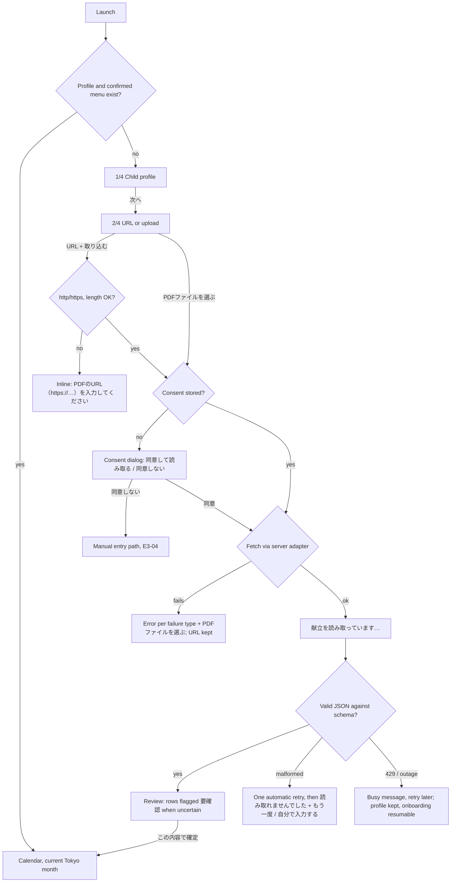
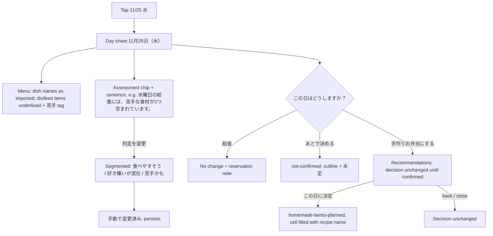

# BentoMinder: screens and flows v0.2 (direction preview)

> Draft, 2026-10-24. Mapped to the story IDs in `docs/ba/user-stories.md` as of today. Quoted Japanese strings that an AC fixes are used verbatim here and in `copy-draft.md`, because QA asserts on them. A frame without a story ID is flagged **[no story]**.

## Screen list

| # | Screen | Type | Stories |
|---|--------|------|---------|
| S1 | Onboarding 1/4: child profile | full screen, stepper | US-E1-01, E1-02, E1-03, E1-04 |
| S2 | Onboarding 2/4: menu URL / upload | full screen, stepper | US-E2-01, E2-02, E2-03 |
| S2c | AI privacy consent (before the first extraction) | dialog | US-E2-08, US-NF-03 |
| S3 | Onboarding 3/4: reading (「献立を読み取っています…」) | full screen | US-E2-04, E2-05, E2-06, US-NF-04 |
| S4 | Onboarding 4/4: review and confirm the menu | editable list | US-E3-01, E3-02, E3-03, E3-04 |
| C1 | Calendar (home), with the today card and upcoming summary at the top | home | US-E5-01, E7-03, E3-06, E8-04, E9-01 |
| D1 | Day sheet | bottom sheet (mobile) / side panel (≥ 1024) | US-E5-02, E4-01, E4-02, E4-03, E4-04, E4-05, E5-04, E5-05, E5-07, E5-08 |
| R1 | Recommendations (3 cards) | full screen | US-E6-01, E6-02, E6-03, E5-03 |
| R2 | Recipe detail | full screen | US-E6-04, E5-06, E7-02/AC2 |
| R3 | Recipe library | full screen | US-E6-05 |
| B1 | Reminder banner: weekly and day-before | in-app banner on C1 | US-E7-01, E7-02, E7-05 |
| P1 | Settings | full screen | US-E7-04, E7-06, E8-01, E1-05, E1-06, E3-05, E10-03, E10-04 |
| H1 | Share text | OS share / copy fallback | US-E9-01, E9-02 |
| X1 | Debug panel | dev-only drawer | US-E11-01, E11-02, E11-03 |

**Navigation.** There is no tab bar. C1 is the only home screen. Its app bar holds the 「日本語 / EN」 segmented toggle (US-E8-01/AC2), レシピ (R3) and 設定 (P1). Every other screen has a back button and the same toggle.

## Flow 1: first launch / onboarding



| Frame | What the parent sees | Story |
|---|---|---|
| S1 | Nickname (optional); age band chips; favourite and disliked chips; diet chips; allergies as chips plus explicit 「わからない」 / 「特になし」 (one is required); themes; optional free text. No birthday, height, weight or gender. | US-E1-02, E1-03, E1-04 |
| S1 error | Allergy question unanswered: inline error under the group on 次へ; focus moves to the group. | US-E1-03 |
| S2 (preview f) | URL field + hint, 「または」, 「PDFファイルを選ぶ」, a box explaining what is sent, primary 「取り込む」. Stepper 2/4. | US-E2-01, E2-03 |
| S2 errors | Inline under the field, with icon and danger border: 「PDFのURL（https://…）を入力してください」. Retrieval failures each have their own message (network / 404 / 403 / HTML), and the upload button becomes primary. | US-E2-01/AC2, E2-02/AC1 |
| S2 upload errors | 「PDFファイルを選んでください」 · 「ファイルが大きすぎます（10MBまで）」 · 「このPDFは読み取れませんでした」 | US-E2-03 |
| S2c | Plain-language notice: only the PDF is sent; free-tier data use; buttons 「同意して読み取る」 and 「同意しない」. | US-E2-08 |
| S3 | Indeterminate progress, bento illustration, stripe band, 「献立を読み取っています…」. Cancel returns to S2. | US-E2-04, E2-06 |
| S4 | One row per school day: date, dish names (editable), allergens as listed (「記載なし」, never "none"), notes, a 給食なし toggle with a reason (no-lunch / bento-day); uncertain rows flagged 要確認 with icon and text. 「この内容で確定」. | US-E3-01, E3-02, E3-03 |
| S4 empty | Zero dates extracted: same as the S3 failure. 「自分で入力する」 opens an empty grid. | US-E3-04 |

## Flow 2: calendar home (preview a, e)

```
┌──────────────────────────────┐
│ BentoMinder [日本語|EN] 📖 ⚙  │  app bar + stripe band
│ [B1 reminder banner, if any] │  US-E7-01 / E7-02
│ Today card                   │  US-E7-03: 今日は給食 + reservation note + 園で予約済み（自分で記録）
│ これからの手作りお弁当         │  US-E5-01/AC7: up to 3 planned days
│  11/18 水 ■ くまさんおにぎり弁当│
│  11/26 木 ■ 星のミニハンバーグ弁当│
│  ┆ 苦手かもの日が1日（7日以内・未計画）│  count line, tap → first such day
│ ‹  2026年11月  ›   [今日]    │  US-E5-01/AC5
│ grid (two indicators per cell)│  US-E5-01/AC3, AC4
│ 表示の見かた (legend)         │
│ [今週の予定を共有]            │  US-E9-01
└──────────────────────────────┘
```

- Tap any day, weekends included, to open D1. Days outside the menu show 「この日は献立に記載がありません」 and no actions (US-E5-02/AC2).
- Month navigation: chevrons with 「前の月」 / 「次の月」 labels. 「今日」 returns to the current month. Year boundaries and leap years are covered by US-E5-01/AC5–AC6.
- A month with no confirmed menu shows every school day as — / 「給食」 and a card 「{month}月の献立がまだありません」 + 「献立を取り込む」 (US-E3-06).
- An outdated menu shows a warning banner with 「献立を取り込む」 (US-E3-06).
- Empty upcoming summary: 「予定している手作りお弁当はありません」 (US-E5-01/AC7).
- Today card states: 「今日は手作りお弁当：<recipe>」 + 「レシピを見る」 · 「今日は給食」 + reservation note · 「今日の予定は未定です」 · 「今日は給食がありません」. On weekends it shows 「次の登園日：11月9日（月）給食」 (US-E7-03). The card rolls over at Tokyo midnight without a reload (AC3).
- Reload and back: a fresh launch always opens the current Tokyo month (US-E5-01/AC1). Within a session, back from D1/R1/R2 returns to the month last viewed.

## Flow 3: day sheet, decision, override (preview b)



| Frame | Notes | Story |
|---|---|---|
| D1, low preference, school lunch | Date header; menu; assessment block (accent-soft, dashed ? chip, explanation, disliked list, 「判定を変更」); three radio cards 給食 / 手作りお弁当にする / あとで決める; reservation note. | US-E5-02, E4-02, E5-04, E5-05, E5-07 |
| D1, planned | Recipe card (name, time, illustration), 「レシピを見る」, 「レシピを変更」, 「給食に戻す」. | US-E5-06 |
| D1, past day | Everything shown; no actions (controls not rendered, not just disabled). | US-E5-02/AC3 |
| D1, no lunch | 「給食なし」 + the original menu text; no planning action. | US-E5-08/AC2 |
| D1, bento day | 「お弁当を計画する」 → R1. | US-E5-08/AC1 |
| D1, not assessed | 「献立が読み取れていないため、判定していません」 + 「献立を確認する」 (S4 row). The decision controls still work. **[wording not fixed by a story]** | US-E4-01 |
| D1, allergen notice | When a declared school-lunch allergen matches a known allergy: a warning row with icon + text (never colour alone). | US-E4-05 |
| Cancel dialog | 「11月4日の手作りお弁当の予定を取り消しますか？」, [取り消す] [キャンセル]. Nothing changes on キャンセル; the reminder is removed on confirm. | US-E5-06/AC2–AC3, E7-02/AC6 |
| Menu refresh | Decisions are kept. If a planned day's menu changed, D1 shows the info line 「献立が更新されました」. | US-E3-05 |

## Flow 4: recommendations → recipe (preview c, d)

- R1 shows exactly 3 ranked cards (US-E6-01). Each card has an illustration, name (Japanese + English), time, up to 2 reasons, allergen line, flags for unknown ingredients 「確認が必要：…」, and 「この日に決定」. Only card 1 uses the red primary button; cards 2 and 3 are outlined.
- Below the cards: 「ほかの候補を見る」, then the disclaimer 「アレルギーへの安全を保証するものではありません。…」 (US-E6-03). When allergy status is 「わからない」, the disclaimer moves above the cards.
- Hard filters remove recipes with a known allergen or diet exclusion (US-E6-02). With fewer than 3 eligible: show what exists + 「条件に合うレシピが{n}件だけ見つかりました」. With zero: an empty state + a link to the profile. **[wording not fixed by a story]**
- R2: a 「…のお弁当に決定」 banner in navy fill, time, theme, allergens, ingredients with quantities, numbered steps, food safety, source, 「レシピを変更」, 「給食に戻す」 (US-E6-04, E5-06).
- A planned recipe that has been removed from the library: the D1 info line and 「レシピを選び直す」 (US-E6-06).

## Flow 5: reminders (preview e)

| Trigger | Web (in-app banner B1) | Android (local notification, v1) | Story |
|---|---|---|---|
| Weekly, Sunday 14:00 JST default | On C1 while open, or on the next open before Monday. Lists each day, e.g. 「11月4日（水）苦手かも・未計画」 + 「計画する」, and 「11月6日（金）手作りお弁当：<recipe>」. Empty: 「来週は手作りお弁当の予定はありません」. | Notification; tap → C1 | US-E7-01 |
| Day-before, 17:30 JST, planned days only | 「明日は手作りお弁当の日！レシピを確認しましょう。」 + recipe name + 「レシピを見る」 → R2 (D1 if the recipe is missing). | Notification; tap → R2 | US-E7-02 |
| Planned after 17:30 | No banner; the today card covers it the next morning. | Same | US-E7-02/AC5 |
| Duplicate / expired | One banner per reminder id; dismissing stores the id. Past reminders are never shown. | Stable ids per date + type | US-E7-05 |
| Permission denied | Not applicable. | Settings shows the status + 「設定を開く」; in-app banners still work. | US-E12-04 |

The web limitation is stated in Settings and once after onboarding: 「ブラウザ版では、アプリを開いているとき・次に開いたときにお知らせします。閉じている間は通知できません。」 (US-E7-06). The web build has no on/off switch that implies background delivery.

## Flow 6: share the weekly plan

Tap 「今週の予定を共有」. This calls `navigator.share`; the fallback is the clipboard + toast 「コピーしました」. If the clipboard is blocked, a dialog shows the text pre-selected. The text contains no allergies, age or profile data (US-E9-02):

```
【BentoMinder】11月16日〜11月20日の予定
11月16日（月）給食
11月17日（火）給食
11月18日（水）手作りお弁当：くまさんおにぎり弁当
11月19日（木）給食
11月20日（金）未定
※給食の予約は園の方法で行ってください（このアプリでは予約されません）
```

## Flow 7: settings

| Section | Contents | Story |
|---|---|---|
| お知らせ | Weekly day + time, day-before time (native `<input type="time">`, 44 px min); web limitation text; Android permission status | US-E7-04, E7-06, E12-04 |
| 表示 | Language 日本語 / English; week start (pending PO decision, see `direction.md` §7); theme 自動 / ライト / ダーク | US-E8-01, **[no story: week start, theme]** |
| 献立表 | Saved URL, 「献立を取り込む」, 「献立を確認・修正」 | US-E2-01/AC4, E3-05 |
| プロフィール | Edit; delete with confirm | US-E1-05, E1-06 |
| データ | 書き出す (JSON export); すべて削除 (two-step confirm) | US-E10-03, E10-04 |

## Flow 8: debug panel

Dev builds only, opened from a small 「DEV」 pill in the bottom-left corner and never present in production bundles (US-E11-01). It provides simulated date/time in Asia/Tokyo, a trigger for the weekly reminder and one for the day-before reminder (E11-02), a sample profile, the 2026-11 sample menu, AI failure simulation (malformed / timeout / 429), clearing local data, and a read-only JSON inspector for decisions (E11-03). A hatched border marks it as non-product UI.
