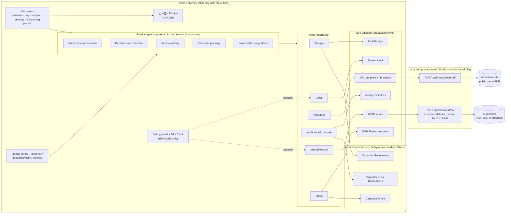

# BentoMinder architecture — overview

Owner: Developer · Status: proposed (awaiting PO approval) · 2026-10-24
Details: ADR 001 (stack), ADR 002 (AI extraction, in progress), ADR 003 (local data), ADR 004 (domain engines), ADR 005 (notifications / Android, in progress).

## 1. In one paragraph
BentoMinder is a web app that runs entirely on the phone or computer. The family's data (child profile, menus, plans) is stored **only on that device**. The only thing that leaves the device is the **school's public menu PDF**, once a month, sent through a small server program we control (the "proxy") to the AI service, which turns it into a structured menu. The parent checks and confirms that menu. From then on, everything — which lunches the child may not enjoy, which three bentos to suggest, when to remind — is calculated by **plain, predictable rules on the device**, with no AI and no network. The same web app is later wrapped as an Android app with Capacitor; only a few small "adapters" (storage, notifications, sharing) are swapped for Android versions.

## 2. Diagram


**Reading the diagram:** screens only talk to the rules engine; the rules engine only talks to **ports** (plug sockets); each environment plugs in its own **adapter**. Tests plug in fakes. Android support = writing three Android adapters, not rewriting the app.

## 3. The ports
| Port | What it does | Web adapter (MVP) | Android adapter (M6/v1) | Test fake |
|------|--------------|-------------------|-------------------------|-----------|
| `Storage` | Read/write the one saved-data document | `localStorage` | Capacitor Preferences | in-memory map |
| `MenuExtractor` | PDF (bytes or URL) → validated menu JSON + uncertainty flags | `fetch('/api/menu/extract')` → proxy → AI (ADR 002) | same HTTP call to a **hosted** adapter (needs a PO decision, §9 risk R2) | fixture JSON per synthetic menu; failure modes (rate limit, malformed, unavailable) |
| `PdfSource` | Get the PDF: from the saved URL or an uploaded file | URL → proxy `fetch-pdf` (browsers can't fetch other sites' PDFs: CORS); upload → `File` bytes | Capacitor native HTTP (no CORS) or file picker | fixture PDFs in `tests/fixtures/menus/` |
| `NotificationScheduler` | Apply the reminder plan: schedule / cancel / list / permission | **In-app only**: reminders appear when the app is open (banner + inbox); no promise of background alerts (brief §11) | Capacitor Local Notifications, exact time, survives app close (ADR 005) | records calls |
| `Clock` | "What time is it?" | `Date.now()` | same | fixed / steppable clock |
| `Share` | Share the weekly plan text | Web Share API if present, else copy to clipboard | Capacitor Share (OS share sheet) | records text |

```ts
// src/domain/ports.ts (interfaces only; details in ADR 002/003/005)
export interface Clock { now(): Instant }
export interface MenuExtractor { extract(input: { pdf: PdfBytes; month?: 'YYYY-MM' }, signal?: AbortSignal): Promise<ExtractResult> }
export type ExtractResult =
  | { ok: true; menu: ExtractedMenu; meta: { model: string; cached: boolean } }
  | { ok: false; error: 'RATE_LIMITED' | 'UNAVAILABLE' | 'MALFORMED_OUTPUT' | 'NOT_A_MENU' | 'TOO_LARGE' | 'NETWORK'; retryAfterSec?: number };
export interface PdfSource { fromUrl(url: string): Promise<PdfResult>; fromFile(file: Blob): Promise<PdfResult> }
export interface NotificationScheduler {
  capabilities(): { background: boolean; exactTime: boolean };   // web: { false, false }
  permission(): Promise<'granted' | 'denied' | 'prompt' | 'not-needed'>;
  requestPermission(): Promise<'granted' | 'denied'>;
  apply(diff: { cancel: number[]; schedule: ReminderJob[] }): Promise<ScheduledJobRef[]>;
  cancelAll(): Promise<void>;
  onTap(handler: (route: string) => void): void;
}
export interface Share { share(text: string): Promise<'shared' | 'copied' | 'cancelled'> }
```

## 4. Folder layout
```
src/
  domain/            pure rules (ADR 004): time/ schema/ menu/ assessment/ decision/ recipes/ reminders/ storage/ ports.ts index.ts
  adapters/
    web/             storage.ts extractor.ts pdf-source.ts notifications.ts clock.ts share.ts
    android/         (M6/v1) storage.ts notifications.ts share.ts pdf-source.ts
    select.ts        picks web or android adapters at start-up (Capacitor.isNativePlatform())
  ui/                screens + components built to design/; router.ts; app-store.tsx (context + reducer)
  i18n/              ja.ts (source of keys) en.ts format.ts (Intl dates, Asia/Tokyo)
  debug/             DebugPanel.tsx, FakeClock, fixture loaders — dev builds only
server/              index.ts (node:http) routes/ extract.ts fetch-pdf.ts cache.ts; ADR 002 fills providers/
data/
  _research/batch-*.json   recipes researched by the BA (sources, own words)
  library.json             GENERATED by npm run merge:research
  dictionary.json          BA's ingredient / category / allergen dictionary
scripts/             validate-data.mjs  merge-research.mjs  check-no-debug.mjs  eval-extraction.mjs (live, opt-in)
tests/
  fixtures/menus/    synthetic Japanese menu PDFs + expected JSON (marked SYNTHETIC)
  fixtures/state/    saved-data documents for every schema version (migrations)
  unit/              Vitest, named by story/AC IDs
  e2e/               Playwright, production build, mocked extractor, page.clock
android/             (M6/v1) Capacitor project, generated by `npx cap add android`
.env.example         GEMINI_API_KEY (name per ADR 002), PROXY_PORT, EXTRACT_CACHE_DIR
```

## 5. Debug panel (development only)
- Mounted only when `import.meta.env.DEV` is true, via `if (import.meta.env.DEV) { const { mountDebug } = await import('./debug/mount') }`. Vite replaces `import.meta.env.DEV` with `false` in production builds and drops the whole branch and chunk.
- **Proof, not trust:** `scripts/check-no-debug.mjs` (a gate command after `build`) fails if any file in `dist/` contains the marker string `__BENTOMINDER_DEBUG__` that the debug module exports.
- Features (brief §15): set a simulated date/time (a `FakeClock` with an offset that replaces the `Clock` port; all reminders and "today" follow it), fire the weekly / day-before reminder now, load the sample child profile, load a sample synthetic menu (bypassing the extractor), make the extractor fail (rate limit / malformed / unavailable), clear local data (same code path as Delete all), inspect the saved document and scheduled reminders.
- E2E tests do **not** depend on the debug panel: they run on the production build and use Playwright's `page.clock` (fake time) and `page.route('/api/**')` (fake extractor). That way the tested build is the shipped build.

## 6. Test strategy (summary; QA owns the full plan)
| Layer | Tool | Runs in gate/CI | What |
|-------|------|-----------------|------|
| Domain unit + property | Vitest | yes | Every rule in ADR 004 on fixtures; coverage ≥ 90 % on `src/domain`; tests named `US-…/ACn` |
| Schema / migrations | Vitest | yes | Every historical state fixture migrates and validates; corrupt-data cases |
| Data | `validate-data.mjs` | yes | Recipe + dictionary schema, unique ids, references resolve, sources present, allergen metadata complete-or-flagged |
| Components | Vitest + Testing Library | yes | Both locales render every screen with no missing key; key states |
| Proxy | Vitest (node) | yes | Schema validation of extractor output, error mapping, cache, SSRF guard on fetch-pdf — provider mocked |
| E2E | Playwright + axe | yes (from M1) | The journey in brief §16 at 390 px and 1280 px, extractor mocked with fixtures, time via `page.clock`, JST with the browser in a non-JST timezone |
| **Live AI eval** | `npm run eval:extraction` | **never** (opt-in, needs a key) | Runs the real extractor on the synthetic fixture PDFs, compares to expected JSON (date mapping, dish recall, no invented allergens), writes `reports/eval-*.json` |

## 7. Milestones
Sizes: S ≈ ½–1 day of agent work, M ≈ 1–2 days, L ≈ 3+ days. QA verifies at the end of each; the PO sees a demo.

| # | Scope (areas / stories) | QA verifies | Size |
|---|-------------------------|-------------|------|
| **M0** | Skeleton: Vite/React/TS, router, i18n with toggle, `jst` module, ports + web adapters stubs, Storage + repository + migrations v1, proxy health endpoint, `validate-data`, `check-no-debug`, local gate green (no CI: repo is local-only) | `gate --stage dev` green; empty app loads at 390/1280 px in ja/en; prod bundle has no debug marker | M |
| **M1** | Onboarding (child profile, PDF URL or upload) + menu import with **mocked** extractor + review/edit screen + confirm; export/delete profile; synthetic menu fixtures | Profile CRUD + export/delete; review edits persist; extraction failures show retry/upload fallback; nothing from the profile in any `/api` request | M |
| **M2** | Assessment engine + overrides, calendar (assessment vs decision visibly distinct), decision state machine, menu replace keeps decisions, outdated-menu warning | Oracle vs engine 0 diffs; full transition table; overrides survive reload + refresh; month boundaries | L |
| **M3** | Recipe library (15–20, BA research), ranking, 3 suggestions, recipe detail, confirm / change / cancel | No known allergen ever in top 3 (property test on real library); unknown flagged; tie-break; selection stored per date | M (+ BA research in parallel) |
| **M4** | Reminder planning + in-app web reminders, settings for times, Today view, share weekly plan, debug panel | Ids stable, diff idempotent, expired dropped, JST correct in non-JST browser; full e2e journey (brief §16) incl. "trigger reminder → reopen recipe" | M |
| **M5** | Real AI extractor via proxy (ADR 002), cache by PDF hash, rate-limit/malformed handling, live eval script | Contract tests with recorded responses in gate; live eval run once by the Orchestrator with the PO's key; accuracy reported, not gated | M |
| **M6** | Android feasibility document (ADR 005): build, notifications, permissions, where the extractor runs on a phone | Doc reviewed; spike build installs on an emulator (if approved) | S |
| **v1** | Android test build: Capacitor shell, Android adapters (Preferences, Local Notifications, Share, native PDF fetch), hosted extractor if approved | Same e2e journey on emulator; notification fires with app closed; permission denied path; timezone change | L |

**MVP = M0–M5 + M6 document.** Expected order of the evidence milestone `mvp` after M5/M6.

## 8. Recommended `quality-gate.json` changes (recommendation only; Orchestrator edits)
1. **`preflight.requireRemote: false`** while the repo is local-only by PO instruction (otherwise preflight is red by design). Flip back when a remote is approved.
2. **`preflight.nodeMajor: 22`** (the proxy uses native TypeScript stripping, Node ≥ 22.18; Node 20 is end-of-life since April 2026).
3. **`commands`** (in order): `npm run validate:data` · `npm run typecheck` (app + server projects) · `npm run coverage` (with `--coverage.thresholds.lines=90` scoped to `src/domain/**` in `vitest.config.ts`) · `npm run build` · **`npm run check:no-debug`** (new) · **`npm run test:e2e`** (new, from M1; Playwright on `vite preview`, mocked extractor). The live eval `npm run eval:extraction` is **not** a gate command.
4. **`generated`**: keep `dist/**` and `data/library.json` ← `data/_research/batch-*.json` by `npm run merge:research`; add `reports/**` and `coverage/**` (tool output, never hand-edited). `android/` is generated by Capacitor in v1 — add `android/app/src/main/assets/public/**` (copied web build) then.
5. **`overlap`** for recipes: `fields` → the recipe's English prose fields as **top-level or dotted string paths** (e.g. `summary.en`, `stepsText.en`, `storageNotes.en`); the tool reads only strings, so steps must also be stored as one string (or a derived `stepsText`) for the check to see them. **Caveat (framework lesson):** the overlap tokenizer only counts `[a-z0-9']` words, so **Japanese text is invisible to it** — copied Japanese prose would pass. Japanese fields need a manual verifier spot-check (or a CJK n-gram check added to the framework — not by us; logged for `docs/framework-lessons.md`).
6. **`trace.pattern`**: keep `US-[A-Z0-9]+-\d+`; tests name `US-…/ACn` (already supported by the pattern).
7. **`budgets`**: keep JS 400 KB / CSS 50 KB gzip; add `data/library.json` ≤ 60 KB gzip as an early warning.
8. **`evidence.testResults`/`testCommand`**: add Playwright's JUnit output (`reports/junit-e2e.xml`) so e2e ACs count.

## 9. Top technical risks
| # | Risk | Likelihood | Impact | Mitigation |
|---|------|-----------|--------|------------|
| R1 | AI extraction maps dishes to the wrong date (table layouts, 令和 headers, merged cells) | High | High | Mandatory review screen; extractor returns per-day uncertainty; date/weekday cross-check (`2026-11-05` must be 木) and Reiwa cross-check in the domain; synthetic fixtures with tricky layouts; live eval (M5) |
| R2 | The Android app has no proxy to call (the dev proxy runs on the laptop) | Certain (for v1) | High | Decide before v1: (a) hosted free-tier function (needs PO approval + deploy) — recommended; (b) import on desktop, transfer menu JSON to phone via export/import; (c) on-device key — rejected (brief §7). ADR 002/005 |
| R3 | Web reminders don't fire when the browser is closed | Certain | Medium | Say so in the UI (brief §11); in-app inbox of due reminders on open; Today view; real background reminders only in the Android build |
| R4 | Free-tier limits, terms or model availability change (rate limits, data used for training) | Medium | Medium | One call/month, cache by PDF hash, retry with backoff only on 429/503, manual entry fallback; privacy note to PO before enabling (ADR 002) |
| R5 | Ingredient dictionary misses school-menu vocabulary → weak assessments | Medium | Medium | Unmatched words → "uncertain", never "enjoyable"; debug view lists unmatched words; BA grows the dictionary from fixtures; overrides |
| R6 | Allergen metadata incomplete in recipes or menus read as "safe" | Low (with filters) | Very high | Hard filters first; unknown → flagged group; `declaredAllergens: null` ≠ none; permanent no-guarantee disclaimer; property test on the real library |
| R7 | Android exact-alarm / notification permission rules (Android 12–14+) block precise reminders | Medium | Medium | ADR 005; inexact fallback acceptable within minutes; permission-denied path tested |
| R8 | Fetching a parent-supplied URL server-side (SSRF, huge files) | Low | Medium | https only, block private/loopback IPs, 10 MB cap, `application/pdf` check, timeout |
| R9 | localStorage cleared by the user/browser → plans lost | Medium | Medium | Export backup prompt after first confirmed month; Preferences on Android; v1 sync seam |

## 10. What needs a PO decision now
- **Approve the stack and the local-only data model** (ADR 001, 003) — recommended as written.
- **How the Android build will reach the AI** (R2): recommend deciding at M6 with ADR 005's findings; the MVP web journey doesn't depend on it.
