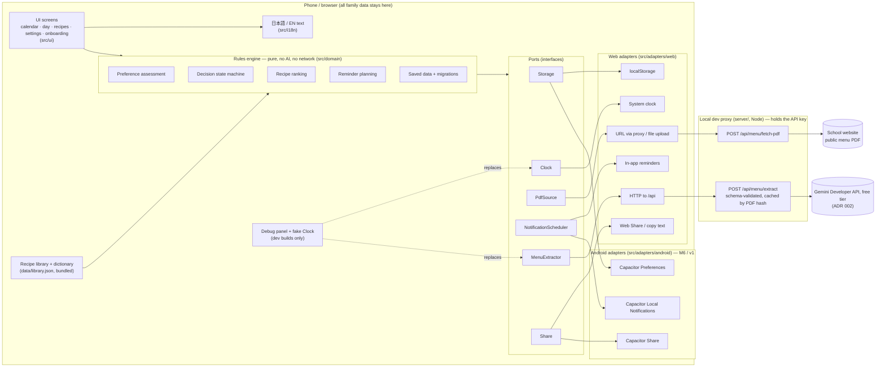

# BentoMinder architecture — overview

Owner: Developer · Status: **approved** by the PO 2026-10-24; aligned at H1 (2026-10-24) · Names: `docs/ba/data-contract.md` v1 wins on every entity, field and state name.
Details: ADR 001 (stack, accepted), ADR 002 (AI extraction, accepted), ADR 003 (local data, accepted), ADR 004 (domain engines, accepted), ADR 005 (notifications: web accepted, Android proposed until M6).

## 1. In one paragraph
BentoMinder is a web app that runs entirely on the phone or computer. The family's data (child profile, menus, plans) is stored **only on that device**. The only thing that leaves the device is the **school's public menu PDF**, once a month, sent through a small server program we control (the "proxy") to the AI service, which turns it into a structured menu. The parent checks and confirms that menu. From then on, everything — which lunches the child may not enjoy, which three bentos to suggest, when to remind — is calculated by **plain, predictable rules on the device**, with no AI and no network. The same web app is later wrapped as an Android app with Capacitor; only a few small "adapters" (storage, notifications, sharing) are swapped for Android versions.

## 2. Diagram


**Reading the diagram:** screens only talk to the rules engine; the rules engine only talks to **ports** (plug sockets); each environment plugs in its own **adapter**. Tests plug in fakes. Android support = writing three Android adapters, not rewriting the app.

## 3. The ports
| Port | What it does | Web adapter (MVP) | Android adapter (M6/v1) | Test fake |
|------|--------------|-------------------|-------------------------|-----------|
| `Storage` | Read/write the one saved-data document | `localStorage` | Capacitor Preferences | in-memory map |
| `MenuExtractor` | PDF bytes + `targetMonth` → validated `ExtractedMenu` v1 + `verification` flags; ≤ 2 provider calls, 0 for a known SHA-256 (BR-10) | `fetch('/api/menu/extract')` → proxy → Gemini (ADR 002) | same HTTP call to a **hosted** adapter (needs a PO decision, §9 risk R2) | fixture JSON per synthetic menu; failure modes (rate limit, malformed, unavailable) |
| `PdfSource` | Get the PDF: from the saved URL or an uploaded file | URL → proxy `fetch-pdf` (browsers can't fetch other sites' PDFs: CORS); upload → `File` bytes | Capacitor native HTTP (no CORS) or file picker | fixture PDFs in `tests/fixtures/menus/` |
| `NotificationScheduler` | Apply the reminder plan: schedule / cancel / list / permission | **In-app only** (BR-18, OQ-14): reminders appear when the app is open or next opened (banner + list + Today view); no system notifications, no promise of background alerts | Capacitor Local Notifications, exact time, survives app close (ADR 005) | records calls |
| `Clock` | "What time is it?" | `Date.now()` | same | fixed / steppable clock |
| `Share` | Share the weekly plan text | Web Share API if present, else copy to clipboard | Capacitor Share (OS share sheet) | records text |

```ts
// src/domain/ports.ts (interfaces only; details in ADR 002/003/005)
export interface Clock { now(): Instant }
export interface MenuExtractor { extract(input: { pdf: PdfBytes; targetMonth: 'YYYY-MM' }, signal?: AbortSignal): Promise<ExtractResult> }
export type ExtractResult =
  | { ok: true; menu: ExtractedMenu; meta: { model: string; cached: boolean; promptVersion: number; schemaVersion: number; providerCalls: 0 | 1 | 2 } }
  | { ok: false; error: 'RATE_LIMITED' | 'UNAVAILABLE' | 'MALFORMED_OUTPUT' | 'NOT_A_MENU' | 'TOO_LARGE' | 'NETWORK'; retryAfterSec?: number; providerCalls: 0 | 1 | 2 };
export interface PdfSource { fromUrl(url: string): Promise<PdfResult>; fromFile(file: Blob): Promise<PdfResult> }
export interface NotificationScheduler {
  capabilities(): { background: boolean; exactTime: boolean };   // web: { false, false }
  permission(): Promise<'granted' | 'denied' | 'prompt' | 'not-needed'>;
  requestPermission(): Promise<'granted' | 'denied'>;
  apply(diff: { remove: string[]; upsert: ReminderJob[] }): Promise<void>;   // keys per data contract ReminderLogEntry (ADR 004 §4)
  cancelAll(): Promise<void>;
  onTap(handler: (route: string) => void): void;
}
export interface Share { share(text: string): Promise<'shared' | 'copied' | 'cancelled'> }
```

## 4. Folder layout
```
src/
  domain/            pure rules (ADR 004): time/ schema/ menu/ assessment/ decision/ recipes/ reminders/ storage/ ports.ts index.ts
  adapters/
    web/             storage.ts extractor.ts pdf-source.ts notifications.ts clock.ts share.ts
    android/         (M6/v1) storage.ts notifications.ts share.ts pdf-source.ts
    select.ts        picks web or android adapters at start-up (Capacitor.isNativePlatform())
  ui/                screens + components built to design/; router.ts; app-store.tsx (context + reducer)
  i18n/              ja.ts (source of keys) en.ts format.ts (Intl dates, Asia/Tokyo)
  debug/             DebugPanel.tsx, FakeClock, fixture loaders — dev builds only
server/              index.ts (node:http) routes/ extract.ts fetch-pdf.ts cache.ts; ADR 002 fills providers/
data/
  _research/batch-*.json   recipes researched by the BA (sources, own words)
  library.json             GENERATED by npm run merge:research
  dictionary.json          GENERATED from docs/ba/domain-dictionary.md by npm run build:dictionary (BA owns the source)
scripts/             validate-data.mjs  merge-research.mjs  build-dictionary.mjs  check-no-debug.mjs  dev.mjs  eval-extraction.mjs (live, opt-in)
tests/
  fixtures/menus/    synthetic Japanese menu PDFs + expected JSON (marked SYNTHETIC)
  fixtures/state/    saved-data documents for every schema version (migrations)
  unit/              Vitest, named by story/AC IDs
  e2e/               Playwright, production build, mocked extractor, page.clock
android/             (M6/v1) Capacitor project, generated by `npx cap add android`
.env.example         GEMINI_API_KEY, GEMINI_MODEL_PRIMARY, GEMINI_MODEL_FALLBACK, AI_ALLOW_PAID_MODELS, PROXY_PORT, EXTRACT_CACHE_DIR (ADR 002)
```

## 5. Debug panel (development only)
- Mounted only when `import.meta.env.DEV` is true, via `if (import.meta.env.DEV) { const { mountDebug } = await import('./debug/mount') }`. Vite replaces `import.meta.env.DEV` with `false` in production builds and drops the whole branch and chunk.
- **Proof, not trust:** `scripts/check-no-debug.mjs` (a gate command after `build`) fails if any file in `dist/` contains the marker string `__BENTOMINDER_DEBUG__` that the debug module exports.
- Features (brief §15): set a simulated date/time (a `FakeClock` with an offset that replaces the `Clock` port; all reminders and "today" follow it), fire the weekly / day-before reminder now, load the sample child profile, load a sample synthetic menu (bypassing the extractor), make the extractor fail (rate limit / malformed / unavailable), clear local data (same code path as Delete all), inspect the saved document and scheduled reminders.
- E2E tests do **not** depend on the debug panel: they run on the production build and use Playwright's `page.clock` (fake time) and `page.route('/api/**')` (fake extractor). That way the tested build is the shipped build.

## 6. Test strategy (summary; QA owns the full plan)
| Layer | Tool | Runs in gate/CI | What |
|-------|------|-----------------|------|
| Domain unit + property | Vitest | yes | Every rule in ADR 004 on fixtures; coverage ≥ 90 % on `src/domain`; tests named `US-…/ACn` |
| Schema / migrations | Vitest | yes | Every historical state fixture migrates and validates; corrupt-data cases |
| Data | `validate-data.mjs` | yes | Recipe + dictionary schema, unique ids, references resolve, sources present, allergen metadata complete-or-flagged, every dictionary ingredient has animal-origin tags or `unknown` (B14), `dietOk` equals the tag-derived set; `data/banned-phrases.json` schema |
| Components | Vitest + Testing Library | yes | Both locales render every screen with no missing key; key states |
| Proxy | Vitest (node) | yes | Schema validation of extractor output, error mapping, cache, SSRF guard on fetch-pdf — provider mocked |
| E2E | Playwright + axe | yes (from M1) | The journey in brief §16 at 390 px and 1280 px, extractor mocked with fixtures, time via `page.clock`, JST with the browser in a non-JST timezone |
| **Live AI eval** | `npm run eval:extraction` | **never** (opt-in, needs a key) | Runs the real extractor on the synthetic fixture PDFs, compares to expected JSON (date mapping, dish recall, no invented allergens), writes `reports/eval-*.json` |

## 7. Milestones
Sizes: S ≈ ½–1 day of agent work, M ≈ 1–2 days, L ≈ 3+ days. QA verifies at the end of each; the PO sees a demo.

| # | Scope (areas / stories) | QA verifies | Size |
|---|-------------------------|-------------|------|
| **M0** | Skeleton: Vite/React/TS, router, i18n with toggle, `jst` module, ports + web adapters stubs, Storage + repository + migrations v1, proxy health endpoint, `validate-data`, `check-no-debug`, local gate green (no CI: repo is local-only) | `gate --stage dev` green; empty app loads at 390/1280 px in ja/en; prod bundle has no debug marker | M |
| **M1** | Onboarding (child profile, PDF URL or upload) + menu import with **mocked** extractor + review/edit screen + confirm; export/delete profile; synthetic menu fixtures | Profile CRUD + export/delete; review edits persist; extraction failures show retry/upload fallback; nothing from the profile in any `/api` request | M |
| **M2** | Assessment engine (BR-04) + overrides, calendar (assessment vs decision visibly distinct; `weekStartsOn`), decision state machine (`school-lunch-planned` / `not-confirmed` / `homemade-bento-planned` / `no-school-lunch`), menu replace keeps decisions (refresh conflicts flagged, `KEEP_PLAN` / `CLEAR_PLAN`, dormant overrides and records; ADR 004 §2 ³), outdated-menu warning | Oracle vs engine 0 diffs; full transition table; overrides survive reload + refresh; month boundaries | L |
| **M3** | Recipe library (15–20, BA research), ranking, 3 suggestions, recipe detail, confirm / change / cancel | No known allergen ever in top 3 (property test on real library); unknown flagged; tie-break; selection stored per date | M (+ BA research in parallel) |
| **M4** | Reminder planning (BR-16/17: weekly covers the next 7 days, day-before for `homemade-bento-planned` only) + in-app web reminders, settings for times, Today view, share weekly plan, debug panel | Ids stable, diff idempotent, expired dropped, JST correct in non-JST browser; full e2e journey (brief §16) incl. "trigger reminder → reopen recipe" | M |
| **M5** | Real AI extractor via proxy (ADR 002), cache by PDF hash, the 2-call budget (repair retry *or* fallback, then stop: BR-10), live eval script | Contract tests with recorded responses in gate; live eval run once by the Orchestrator with the PO's key; accuracy reported, not gated | M |
| **M6** | Android feasibility document (ADR 005): build, notifications, permissions, where the extractor runs on a phone | Doc reviewed; spike build installs on an emulator (if approved) | S |
| **v1** | Android test build: Capacitor shell, Android adapters (Preferences, Local Notifications, Share, native PDF fetch), hosted extractor if approved | Same e2e journey on emulator; notification fires with app closed; permission denied path; timezone change | L |

**MVP = M0–M5 + M6 document.** Expected order of the evidence milestone `mvp` after M5/M6.

## 8. `quality-gate.json` changes (agreed at H1; the final JSON is in §11.4, applied by the Orchestrator at M0)
1. **`preflight`**: `requireRemote: false` while the repo is local-only (flip back when a remote is approved); `nodeMajor: 22` (native TypeScript stripping needs Node ≥ 22.18; Node 20 is end-of-life).
2. **`commands`** in order: validate data · lint (new) · typecheck · unit + coverage (≥ 90 % on `src/domain/**`, set in `vitest.config.ts`) · build · no debug in build (new, BR-24) · e2e (new, Playwright smoke from M0, full journey from M4). The live eval is never a gate command.
3. **`generated`**: add `data/dictionary.json` (from the BA's dictionary by `npm run build:dictionary`), `coverage/**`, `reports/**`. In v1 add the Capacitor copy of the web build (`android/app/src/main/assets/public/**`).
4. **`docs.required`**: add the data contract, this document and `data/banned-phrases.json` (BA-owned list of phrases the UI must never contain: allergy-safety claims, reservation claims, background-reminder promises; BR-07, BR-18, BR-19). It is data, not a doc: `docs.required` is only the release gate's existence check; `validate:data` checks its schema and a unit test (`tests/unit/ui/banned-phrases.test.ts`) reads it and scans both locale catalogs. The Developer never edits its content.
5. **`budgets`**: keep JS 400 KB / CSS 50 KB gzip; add `data/library.json` ≤ 60 KB gzip as an early warning. Fonts are measured, not budgeted (ADR 001).
6. **`overlap.fields`**: the recipe's English prose at dotted paths with array indexes (`description.en`, `steps.N.en`, `storage.N.en`, `adaptations.N.en`, `makeAhead.en`). **Caveat (framework lesson):** the tokenizer counts only `[a-z0-9']` words, so Japanese text is invisible to it; Japanese own-words checks stay a manual verifier spot-check.
7. **`trace`**: `allowUntested` lists the whole-v1 stories (`US-E7-08`, `US-E12-02`, `US-E12-03`, `US-E12-04`; PLAN §7 "H1 non-blocking"), so the MVP release gate does not demand tests for stories that must not be built yet. Each id is removed when its v1 milestone starts. `US-E3-06` is **not** listed: it is an MVP story with one v1 AC (AC4), and `trace` checks story ids, so AC1–AC3 tests satisfy it. **`evidence`**: unchanged (the pattern already accepts `US-…/ACn`; `reports/junit*.xml` already matches the e2e JUnit file).

## 9. Top technical risks
| # | Risk | Likelihood | Impact | Mitigation |
|---|------|-----------|--------|------------|
| R1 | AI extraction maps dishes to the wrong date (table layouts, 令和 headers, merged cells) | High | High | Mandatory review screen; extractor returns per-day uncertainty; date/weekday cross-check (`2026-11-05` must be 木) and Reiwa cross-check in the domain; synthetic fixtures with tricky layouts; live eval (M5) |
| R2 | The Android app has no proxy to call (the dev proxy runs on the laptop) | Certain (for v1) | High | Decide before v1: (a) hosted free-tier function (needs PO approval + deploy) — recommended; (b) import on desktop, transfer menu JSON to phone via export/import; (c) on-device key — rejected (brief §7). ADR 002/005 |
| R3 | Web reminders don't fire when the browser is closed | Certain | Medium | Say so in the UI (BR-18); missed reminders shown on next open until they expire (BR-17); Today view; real background reminders only in the Android build |
| R4 | Free-tier limits, terms or model availability change (rate limits, data used for training) | Medium | Medium | One import/month, 0 calls for a known PDF hash, ≤ 2 calls per import (BR-10: repair retry *or* fallback model, then stop), upload/manual entry fallback; privacy notice before the first import; Japan-only free tier (ADR 002) |
| R5 | Ingredient dictionary misses school-menu vocabulary → weak assessments | Medium | Medium | Unmatched words → "uncertain", never "enjoyable"; debug view lists unmatched words; BA grows the dictionary from fixtures; overrides |
| R6 | Allergen metadata incomplete in recipes or menus read as "safe" | Low (with filters) | Very high | Hard filters first; unknown → flagged group; `declaredAllergens: null` ≠ none; permanent no-guarantee disclaimer; property test on the real library |
| R7 | Android exact-alarm / notification permission rules (Android 12–14+) block precise reminders | Medium | Medium | ADR 005; inexact fallback acceptable within minutes; permission-denied path tested |
| R8 | Fetching a parent-supplied URL server-side (SSRF, huge files) | Low | Medium | https only, block private/loopback IPs, 10 MB cap, `application/pdf` check, timeout |
| R9 | localStorage cleared by the user/browser → plans lost | Medium | Medium | Export backup prompt after first confirmed month; Preferences on Android; v1 sync seam |

## 10. Decisions and reconciliations (H1, 2026-10-24)
| Item | Status | Where |
|------|--------|-------|
| Stack, local-only data model, domain engines | Approved by the PO; ADR 001, 003, 004 accepted | ADRs |
| R-1 retry policy | **Closed**: BR-10's 2-call budget (call 1 primary; call 2 = one repair retry *or* the fallback model on 429/408/5xx/timeout; then stop with `RATE_LIMITED` / `UNAVAILABLE` / `MALFORMED_OUTPUT`; 400/403/404 never retried; 0 calls for a known PDF hash) | ADR 002 §5, contract `ai-call-budget` |
| R-2 state names | **Closed**: the data contract's names everywhere (`school-lunch-planned`, `homemade-bento-planned`, `not-confirmed`, `no-school-lunch`) | ADR 004 §2 |
| R-3 ranking vs allergen data | **Closed**: hard filters first (allergens, may-contain, excluded ingredients via dictionary parents, diet via dictionary animal-origin tags; unknown origin with a selected diet excluded, PLAN §7 B14); `allergenDataComplete = false` excluded when the child has known allergens, else ranked last and flagged; then BR-09's exact score and tie-break | ADR 004 §3, contract `ranking-hard-filter`, `ranking-incomplete-allergen` |
| R-4 desktop notification | **Closed** (OQ-14): web reminders are in-app only; the tab-open system notification is a later option | ADR 005 §1 |
| AI region | **Closed**: Japan only, free tier, AI Studio project without billing; parents-only tool (18+) | ADR 002 |
| H1 rulings on QA blockers (B1, B2, B4, B5, B6, B7, B10, B14, non-blocking) | **Applied** 2026-10-24: D/L = distinct found dictionary ids, most specific profile entry wins, `mixedUnknown`/`mixedNeutral` split, ambiguity → U; no-lunch over override (dormant); refresh-conflict rows + `KEEP_PLAN`; `plannedAt` for day-before suppression; diet on animal-origin tags; short-name snapshot; `banned-phrases.json` and `trace.allowUntested` in §11.4 | ADR 004 §1–§4, PLAN §7 |
| Hosted extractor for Android (R2) | **Open**, decided at M6 with ADR 005's Android findings; the MVP web journey doesn't depend on it | ADR 002 decision 2, ADR 005 §4 |

## 11. M0 task list (dispatchable)
Goal: an empty but real app that passes `gate --stage dev` locally, so M1–M5 only add features. Scope is infrastructure; no product screens beyond a placeholder calendar shell and the language toggle. **Node ≥ 22.18** required (ADR 001).

### 11.1 Dependencies
| Kind | Packages |
|------|----------|
| runtime | `react`, `react-dom`, `zod` (v4), `@fontsource/zen-maru-gothic` |
| dev | `vite`, `@vitejs/plugin-react`, `typescript`, `@types/react`, `@types/react-dom`, `@types/node`, `vitest`, `@vitest/coverage-v8`, `jsdom`, `@testing-library/react`, `@testing-library/user-event`, `@testing-library/jest-dom`, `fast-check` (property tests, ADR 004), `@playwright/test`, `@axe-core/playwright`, `eslint`, `@eslint/js`, `typescript-eslint`, `eslint-plugin-react`, `eslint-plugin-react-hooks` |

No other runtime dependency without an ADR update.

### 11.2 `package.json` (scripts are the contract with the gate)
```json
{
  "name": "bentominder",
  "private": true,
  "type": "module",
  "engines": { "node": ">=22.18" },
  "scripts": {
    "dev": "node scripts/dev.mjs",
    "dev:web": "vite",
    "dev:proxy": "node --env-file-if-exists=.env server/index.ts",
    "build": "vite build",
    "preview": "vite preview --port 4173 --strictPort",
    "typecheck": "tsc -p tsconfig.app.json && tsc -p tsconfig.server.json && tsc -p tsconfig.node.json",
    "lint": "eslint .",
    "test": "vitest run",
    "coverage": "vitest run --coverage --reporter=default --reporter=junit --outputFile.junit=reports/junit.xml",
    "test:e2e": "playwright test",
    "build:dictionary": "node scripts/build-dictionary.mjs",
    "merge:research": "node scripts/merge-research.mjs",
    "validate:data": "node scripts/validate-data.mjs",
    "check:no-debug": "node scripts/check-no-debug.mjs",
    "eval:extraction": "node --env-file=.env scripts/eval-extraction.mjs"
  }
}
```
`coverage` is exactly `evidence.testCommand` in `quality-gate.json`, so milestone evidence and the gate run the same thing. `test:e2e` expects a fresh `dist/` (the gate builds first); `eval:extraction` is a stub that exits with "M5" until M5 and is **never** a gate command.

### 11.3 Files M0 creates
| Path | Content |
|------|---------|
| `tsconfig.json` | references only |
| `tsconfig.app.json` | `src/`, `tests/`; `strict`, `noUncheckedIndexedAccess`, `exactOptionalPropertyTypes`, `erasableSyntaxOnly`, `verbatimModuleSyntax`, `allowImportingTsExtensions`, `noEmit`, `jsx: react-jsx`, `lib: ES2022 + DOM` |
| `tsconfig.server.json` | `server/` + `src/domain/schema/`; same strictness, `types: [node]`, no DOM lib (imports use `.ts` extensions so Node runs them directly) |
| `tsconfig.node.json` | `vite.config.ts`, `vitest.config.ts`, `playwright.config.ts`, `eslint.config.js` |
| `vite.config.ts` | `base: './'`; `build.target: ['es2022', 'chrome111']`; `server.proxy['/api'] → http://127.0.0.1:8787`; `define` nothing secret |
| `vitest.config.ts` | `test.projects`: **domain** (`environment: node`, `tests/unit/domain/**`), **ui** (`jsdom`, `tests/unit/ui/**`, setup `tests/setup/dom.ts`), **tz** (domain time tests re-run with `env: { TZ: 'America/Los_Angeles' }`); coverage `provider: v8`, `include: ['src/domain/**']`, `thresholds: { lines: 90, branches: 90, functions: 90, statements: 90 }`, reporters `text`, `json-summary` (→ `coverage/coverage-summary.json`, read by evidence), `html` |
| `playwright.config.ts` | `testDir: tests/e2e`; `webServer: { command: 'npm run preview', port: 4173, reuseExistingServer: true }`; projects **mobile** (Chromium, 390×844, `hasTouch`, `timezoneId: 'Europe/Paris'`, `locale: 'en-US'`) and **desktop** (Chromium, 1280×800, `timezoneId: 'America/Los_Angeles'`, `locale: 'en-US'`): both non-JST and non-ja on purpose (BR-15, BR-23); reporters `list` + `junit` → `reports/junit-e2e.xml` |
| `eslint.config.js` | typescript-eslint strict; `react/jsx-no-literals` in `src/ui/**` (strings only from `src/i18n`, BR-23); `no-restricted-globals` / `no-restricted-properties` for `localStorage`, `indexedDB`, `Notification`, `navigator.share`, `navigator.clipboard`, `Date.now`, `new Date()` everywhere except `src/adapters/web/**` (ADR 001 WebView rules); `no-restricted-imports`: `src/domain/**` may not import `src/ui`, `src/adapters`, `react` |
| `index.html` | `<html lang="ja">`, viewport meta, `#root` |
| `src/main.tsx` | picks adapters (`src/adapters/select.ts`), loads the store, mounts `App`; `if (import.meta.env.DEV)` dynamic-imports `src/debug/mount.tsx` |
| `src/ui/App.tsx`, `src/ui/router.ts`, `src/ui/app-store.tsx` | hash router (`#/calendar/<YYYY-MM>`, `#/day/<date>`, `#/recipe/<id>`, `#/settings`, `#/onboarding/<step>`), context + reducer, placeholder calendar shell with the ja/EN toggle in the app bar; `data-testid` on the toggle and shell |
| `src/ui/styles/global.css` | imports `design/tokens.css` (single source, not copied) and the two Zen Maru Gothic weights; `data-theme` switch |
| `src/i18n/ja.ts`, `en.ts`, `index.ts` | typed dictionaries (`en satisfies Dictionary<typeof ja>`), `t(key, params)`, `format.ts` (Intl, Asia/Tokyo); seeded from `design/copy-draft.md` for the shell only |
| `src/domain/time/jst.ts` | `LocalDate`, `Instant`, `todayJst(now)`, `jstWallToInstant(date, 'HH:MM')`, `addDays`, `weekdayOf`, `monthGrid(month, weekStartsOn)`, `daysInMonth`, `reiwaToGregorian` |
| `src/domain/ports.ts` | `Clock`, `Storage`, `MenuExtractor`, `PdfSource`, `NotificationScheduler`, `Share` (as §3) |
| `src/domain/schema/*.ts` | zod schemas for the whole contract v1 (store, settings, profile, extracted/confirmed menu, override, decision, reminder log, recipe, dictionary), each rule id as the issue message; `extracted-menu.ts` exports the JSON Schema via `z.toJSONSchema()` |
| `src/domain/storage/repository.ts`, `migrations/index.ts` | ADR 003 (`load`/`save`/`exportJson`/`importJson`/`deleteAll`, prev copy, corrupt/too-new results); migrations map empty at v1 |
| `src/domain/rules.ts` | BR-04 / BR-09 / BR-16 constants (ADR 004) |
| `src/adapters/web/storage.ts`, `clock.ts` | real; `extractor.ts`, `pdf-source.ts`, `notifications.ts`, `share.ts`: typed stubs that return `UNAVAILABLE` / no-op |
| `src/adapters/select.ts` | web adapters (Android branch added in v1) |
| `src/debug/mount.tsx`, `src/debug/marker.ts` | empty panel + exported marker `__BENTOMINDER_DEBUG__` |
| `server/index.ts` | `node:http` on `127.0.0.1:${PROXY_PORT ?? 8787}`; `GET /api/health` → `{ ok: true, version }`; every other `/api` route 404 until M1/M5 |
| `scripts/dev.mjs` | spawns `dev:proxy` and `dev:web`, forwards signals (no `concurrently` dependency) |
| `scripts/build-dictionary.mjs` | parses the tables in `docs/ba/domain-dictionary.md` → `data/dictionary.json` (generated; never hand-edited) |
| `scripts/merge-research.mjs` | `data/_research/batch-*.json` → `data/library.json` (sorted by id; `[]` when there are no batches) |
| `scripts/validate-data.mjs` | runs the zod schemas + cross-field and cross-entity rules (contract §2–§4) on `data/dictionary.json`, `data/library.json`, `data/_research/batch-*.json`, `tests/fixtures/state/*.json`, `tests/fixtures/menus/*.json`; prints `<file> <rule-id> <path>`; exit 1 on any error |
| `scripts/check-no-debug.mjs` | fails if any `dist/**` file contains `__BENTOMINDER_DEBUG__` (BR-24) |
| `scripts/eval-extraction.mjs` | stub until M5 |
| `tests/unit/domain/*.test.ts` | jst (month/year/leap boundaries; Tokyo midnight vs device date), schema (each rule id at least once), repository (round trip, prev recovery, corrupt, too-new, delete-all), import boundaries; titles name story IDs (US-E8-03, US-E10-01, US-E10-02, US-E10-04, US-E10-05) |
| `tests/unit/ui/*.test.tsx` | every key exists in both locales; shell renders in ja by default whatever `navigator.language` (US-E8-01, US-E8-02) |
| `tests/e2e/smoke.spec.ts` | app opens in Japanese on both projects, toggle to EN and back within one tap, today is the Tokyo date, axe 0 serious/critical (US-E8-01, US-E5-01/AC1) |
| `tests/fixtures/state/v1.json` | frozen valid v1 store (ADR 003) |
| `.env.example` | `GEMINI_API_KEY=`, `GEMINI_MODEL_PRIMARY=gemini-3.8-flash`, `GEMINI_MODEL_FALLBACK=gemini-3.5-flash-lite`, `AI_ALLOW_PAID_MODELS=false`, `PROXY_PORT=8787`, `EXTRACT_CACHE_DIR=server/.cache`, each with a one-line comment |
| `.gitignore` | add `server/.cache/`, `data/_research/.cache/` (already ignored: `dist/`, `coverage/`, `reports/`, `.cache/`, `.env*`) |

The M0 story tests above name only stories M0 actually satisfies; the remaining stories keep failing `trace` until their milestone (that is the release gate's job, not dev's).

### 11.4 `quality-gate.json` (final snippets; the Orchestrator applies them, keys not shown stay as they are)
```json
{
  "commands": [
    { "name": "validate data", "run": "npm run validate:data" },
    { "name": "lint", "run": "npm run lint" },
    { "name": "typecheck", "run": "npm run typecheck" },
    { "name": "unit + coverage", "run": "npm run coverage" },
    { "name": "build", "run": "npm run build" },
    { "name": "no debug in build", "run": "npm run check:no-debug" },
    { "name": "e2e", "run": "npm run test:e2e" }
  ],
  "generated": [
    { "path": "dist/**", "by": "npm run build" },
    { "path": "data/library.json", "from": "data/_research/batch-*.json", "by": "npm run merge:research" },
    { "path": "data/dictionary.json", "from": "docs/ba/domain-dictionary.md", "by": "npm run build:dictionary" },
    { "path": "coverage/**", "by": "npm run coverage" },
    { "path": "reports/**", "by": "npm run coverage, npm run test:e2e, npm run eval:extraction" }
  ],
  "docs": {
    "required": [
      "CATCH-UP.md",
      "docs/PLAN.md",
      "docs/PROJECT_BRIEF.md",
      "docs/ba/user-stories.md",
      "docs/ba/data-contract.md",
      "docs/dev/architecture.md",
      "data/banned-phrases.json"
    ]
  },
  "trace": {
    "allowUntested": ["US-E7-08", "US-E12-02", "US-E12-03", "US-E12-04"]
  },
  "budgets": [
    { "name": "JS bundle", "glob": "dist/assets/*.js", "maxGzipKb": 400 },
    { "name": "CSS", "glob": "dist/assets/*.css", "maxGzipKb": 50 },
    { "name": "Recipe library", "glob": "data/library.json", "maxGzipKb": 60 }
  ],
  "overlap": {
    "fields": [
      "description.en",
      "steps.0.en", "steps.1.en", "steps.2.en", "steps.3.en", "steps.4.en", "steps.5.en",
      "steps.6.en", "steps.7.en", "steps.8.en", "steps.9.en", "steps.10.en", "steps.11.en",
      "storage.0.en", "storage.1.en", "storage.2.en", "storage.3.en",
      "adaptations.0.en", "adaptations.1.en", "adaptations.2.en", "adaptations.3.en",
      "makeAhead.en"
    ]
  },
  "preflight": { "nodeMajor": 22, "requireRemote": false, "optional": ["gh", "playwright"] }
}
```
Notes:
- `docs` and `overlap` are merged key by key by `validate.mjs` (`loadConfig` shallow-merges objects), so `docs.catchUp`, `decisionLog`, `overlap.records`, `cacheDir` etc. stay as configured.
- **Overlap paths**: the tool reads only string values at dotted paths (`get()` splits on `.`, so array indexes work); the indexes cover the contract maxima (12 steps). It counts only `[a-z0-9']` words, so the `.ja` text is invisible to it: Japanese own-words checking stays a manual verifier spot-check (BR-26, FL-07).
- `trace` is merged key by key too, so `stories`, `tests` and `pattern` stay as configured; only `allowUntested` changes (v1 stories, see §8 item 7).
- `data/banned-phrases.json` is BA-owned source data, not `generated`; it is in `docs.required` only so the release gate fails if it is missing.
- `requireRemote: false` until the PO approves a remote (plan §5 H5); flip back then.
- `evidence.testCommand` and `evidence.testResults` (`reports/junit*.xml`) already match `npm run coverage` and Playwright's `reports/junit-e2e.xml`; no change.
- `stages` unchanged: `dev` = preflight, secrets, commands, budget; `release` adds docs, trace, overlap, evidence.

### 11.5 M0 done when
`node .claude/skills/quality-gate/scripts/validate.mjs gate --stage dev` is green on the PO's Windows PC; `npm run dev` serves the shell at 390 px and 1280 px in ja and EN; `GET /api/health` answers; `dist/` has no debug marker; ADR 001 records the measured first-screen font transfer and bundle size.
